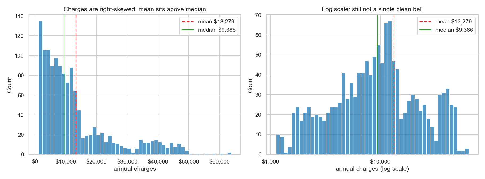
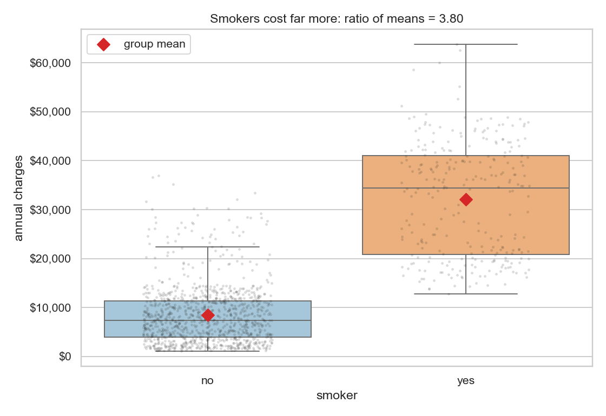
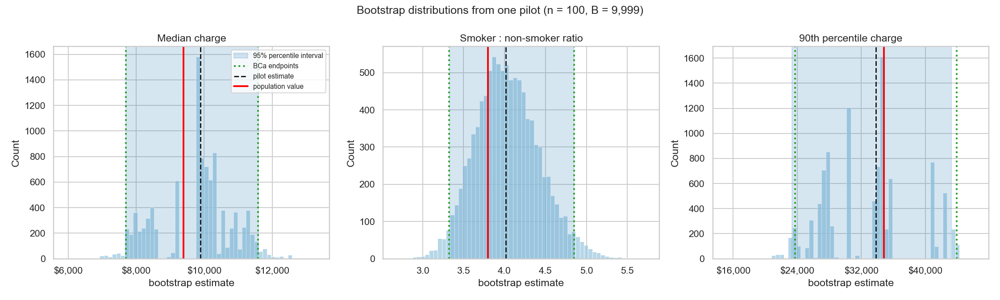
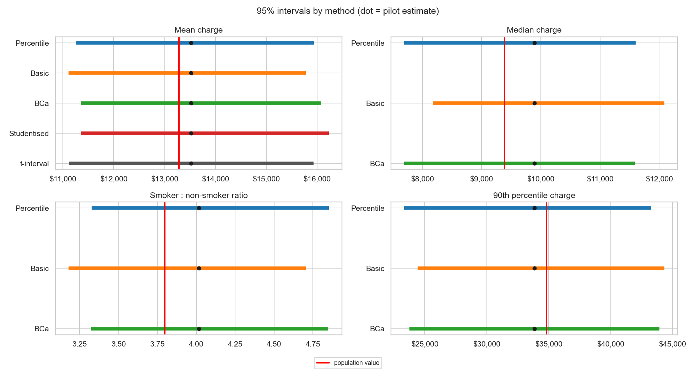
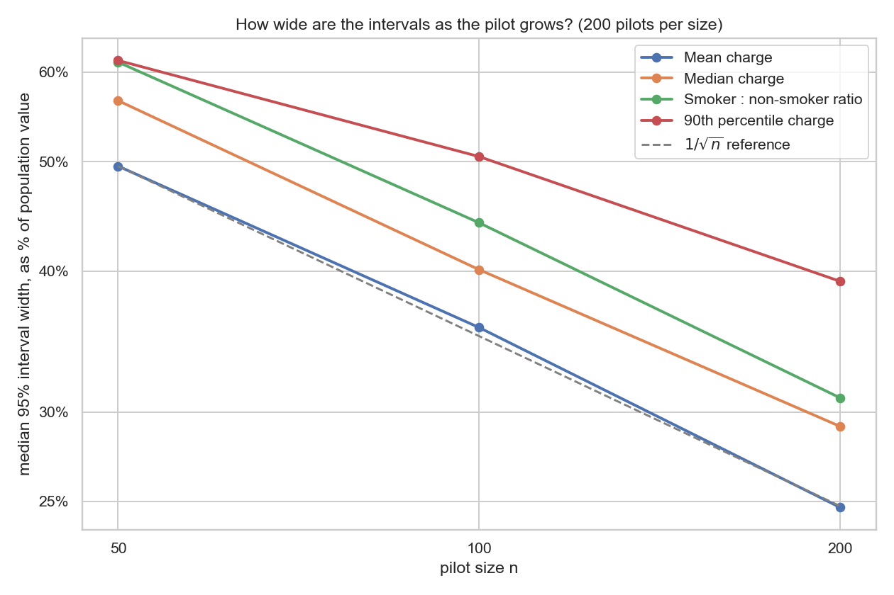
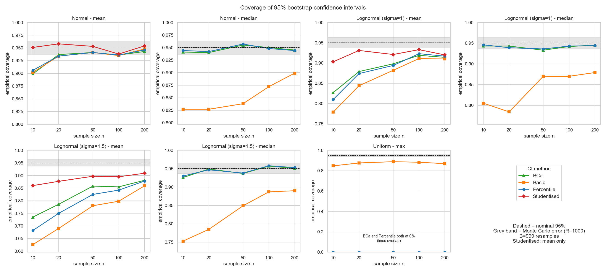
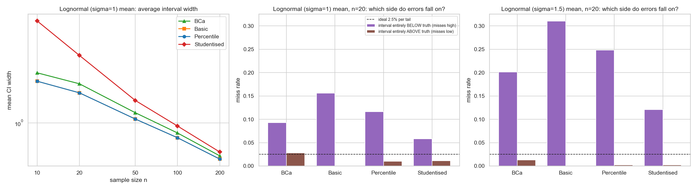
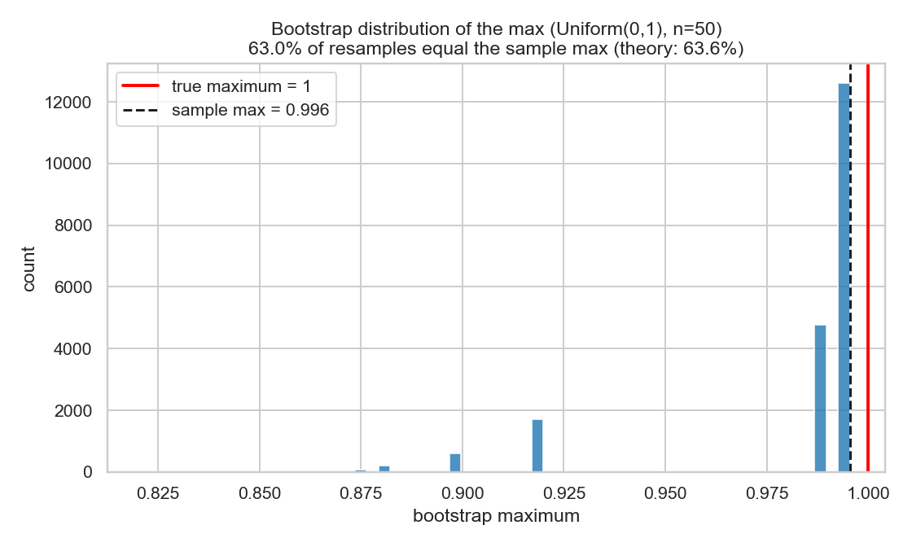

---

layout: default

title: Health Insurance Charges (Bootstrap Confidence Intervals)

permalink: /bootstrap-confidence-intervals/

---

# This project is in development

## Goals and objectives:

**The business problem.** A regional health insurer is preparing to launch a new product. Before committing, the pricing team has gathered a small pilot sample of 100 policyholders and their annual charges. The head of underwriting must set three numbers from it:

* **The typical annual charge (median).** This anchors the base premium.
* **The ratio of mean charges for smokers to non-smokers.** This drives the premium loading applied to smokers.
* **The 90th-percentile charge.** This informs the threshold at which stop-loss or reinsurance cover should begin.

A pilot of 100 cannot pin any of these down exactly. The useful question is not "what is the number?" but "how wrong could it plausibly be?", because a premium loading built on an estimate of 4.0 means something very different if the plausible range is 3.9–4.1 than if it is 3.3–4.9.

**The analytical question.** How precisely can these three quantities be estimated from a pilot of 100 policyholders, and can the method used to express that uncertainty be trusted when charges are heavily skewed?

**How the answer would be used.** The interval around the smoker ratio tells underwriting how much margin to build into the loading. The interval around the 90th percentile indicates how firmly a reinsurance threshold can be set, or whether it should wait for more data. Comparing interval widths at pilot sizes of 50, 100 and 200 answers a practical question directly: is the pilot big enough, or is more recruitment worth the cost?

**Why not a standard test?** Charges are right-skewed, and two of the three quantities have no tidy textbook interval. The median and the 90th percentile have no simple standard-error formula, and the ratio of two means has only an approximate one that leans on normality. The bootstrap sidesteps this by estimating the uncertainty directly from the sample itself. It is also a fair question whether the bootstrap can be relied upon, so the project is structured in two parts:

* **Part A (applied):** bootstrap intervals for the three quantities from a single pilot sample, checked against known population values.
* **Part B (validation):** a simulation study of how often bootstrap intervals contain the truth, across four distributions, five sample sizes and four interval methods, including a case where the bootstrap is known to fail.

### Objectives

1. Build and compare bootstrap intervals (percentile, basic, BCa and, for the mean, studentised) against a textbook t-interval.
2. Quantify how interval width shrinks as the pilot grows from 50 to 200 policyholders.
3. Measure empirical coverage of each interval method in a controlled simulation, and identify where each breaks down.
4. Draw practical guidance on which interval method to use, and when not to use the bootstrap at all.

The value of the project lies in the method and the honest account of its limits, not in any pricing figure: the data is simulated, and nothing here is a real premium recommendation.

## Application:  

**The technique.** The bootstrap estimates the uncertainty of a statistic by treating the sample as a stand-in for the population. It repeatedly resamples the observed data with replacement, recomputes the statistic each time, and reads the spread of those recomputed values as a measure of how much the statistic would vary from sample to sample. Different ways of turning that spread into a confidence interval give the percentile, basic, BCa and studentised methods compared in this project.

**When it is used.** It earns its place when:

the statistic has no convenient formula, such as a median, percentile, ratio or a model's performance metric;
the data is skewed or the sample is too small to trust normal approximations;
or an analyst simply needs a method that works the same way for any statistic, so that one tool covers many questions.

Its main benefits are generality, minimal distributional assumptions, and the fact that it can be implemented in a few lines and run cheaply on a standard laptop. Its main limitations are that it is only as good as the sample, can under-cover badly in small or heavily skewed samples, and fails outright for some statistics, such as the sample maximum. Part B examines each of these.

This approach is applicable across many sectors and scenarios. Practical examples showing where this provides clear business value include:

🏦 **Insurance and finance**  
Actuaries and risk teams need uncertainty ranges for tail quantities such as value-at-risk and large-loss thresholds, and for loss ratios between segments. These are exactly the median-, ratio- and percentile-type statistics studied here, usually estimated from limited claims history.  

🏥 **Healthcare and clinical research**  
Hospital costs and lengths of stay are strongly skewed, so a t-interval on the mean cost can be unreliable in small trials. Bootstrap intervals for mean or median cost differences between treatments support health-economic evaluations of whether a new treatment is worth its price.

🚆 **Operations and logistics**  
Service-level agreements are typically phrased as percentiles ("90% of deliveries within X hours"). A bootstrap interval around a delivery-time percentile shows whether an observed result is comfortably inside the target or merely lucky.

🛍️ **Retail and machine learning**  
Revenue per customer is skewed, so experiment teams often bootstrap differences in medians or trimmed means rather than relying on normal approximations. The same resampling idea underlies bagging in the Random Forest project, and bootstrapping the held-out test set gives an interval around metrics such as accuracy, where the point estimate alone (for example, 95.61% on 114 observations) conveys little about how much to trust it.  

**Relationship to existing portfolio pages.** The One-Sample T-Test page relies on the Central Limit Theorem at n = 150, and the A/B Testing page uses normal-approximation intervals for conversion rates. The bootstrap is the natural alternative when those assumptions are doubtful: skewed continuous outcomes, small samples, or statistics beyond the mean.

Details of how this is applicable to multiple industries to solve business problems, generate insight and provide tangible business benefits. 

## Methodology:  

### Dataset

The analysis uses the **Medical Cost Personal Dataset** (insurance.csv), available at [https://www.kaggle.com/datasets/mirichoi0218/insurance](https://www.kaggle.com/datasets/mirichoi0218/insurance). It holds 1,338 rows and seven columns: age, sex, BMI, number of children, smoker status, US region and charges. There are no missing values.

**What charges represents, and what it doesn't.** The dataset's own documentation describes charges only as "individual medical costs billed by health insurance". That wording is ambiguous: it does not say whether the figure is a claim payout, an amount billed, or something closer to a premium, and the data carries no claim dates, deductibles or co-payments. The data offers some clues. Charges rise sharply with smoking, age and BMI, as medical costs do. Every one of the 1,337 records is positive, with a minimum of $1,121.87 and no zeros, which real claims data would not look like, since many policyholders claim nothing in a given year. This project therefore treats charges as annual medical cost per policyholder, and makes no claim that these are payouts.

**The data is simulated.** The dataset is described as synthetic, generated from US Census Bureau demographic statistics for use in a machine-learning textbook, not drawn from real insurance records. Nothing here is evidence about real premiums or real people. The business scenario is a framing device for demonstrating the technique, and the write-up treats it as such.

### Known features of the data:

* **One exact duplicate row**, identical in all seven columns including charges to four decimal places, which makes coincidence very unlikely. It was removed, leaving 1,337 rows. One row in 1,338 changes nothing material, but the decision is recorded rather than hidden.  
* **Skewed charges**: skewness 1.51 overall, with a mean of $13,279 well above the median of $9,386.  
* **A mixture, not a single skewed shape**. Skewness comes almost entirely from the 1,063 non-smokers (1.54), while the 274 smokers (20.5% of the data) are close to symmetric (0.13) and cost far more on average. Figure 1 shows the combined distribution and Figure 2 splits it by smoker status.

### Analytical design

**The "known population" device**. A real pilot never reveals the true answer, so it cannot show whether an interval was right. To get around this, the full cleaned dataset is treated as a known population, with true values for the mean ($13,279.12), median ($9,386.16), smoker-to-non-smoker ratio of mean charges (3.80) and 90th percentile ($34,832.74). This is a finite dataset, not a true infinite population, so the values are "truths" for the exercise only.

**The pilot**. One simple random sample of 100 policyholders was drawn without replacement, with a fixed seed. It was not stratified, because a real pilot could not guarantee how many smokers it would recruit. It contained 22 smokers.

**Interval methods**. For each statistic, 95% intervals were built by:

* the **percentile** method (the middle 95% of the bootstrap distribution);  
* the **basic** (reverse-percentile) method;  
* **BCa** (bias-corrected and accelerated), which adjusts for bias and skewness;  
* the **studentised** (bootstrap-t) method, for the mean only, since it needs a standard error for every resample and a nested bootstrap for the other statistics was not worth the cost;  
* a standard **t-interval** for the mean as a textbook baseline.

### Key methodological decisions

* **Stratified resampling for the ratio.** Smokers and non-smokers were resampled separately, which holds group sizes fixed. Plain resampling would sometimes draw very few or zero smokers, adding noise the real pilot did not have.
* **B = 9,999 resamples for the pilot, 999 for the simulation.** With B + 1 = 10,000, the 2.5% and 97.5% cut-points fall exactly on whole order statistics, and tail percentiles need many resamples to be stable. The simulation builds hundreds of thousands of intervals, so it uses 999 (with the same property) to stay within CPU limits.
* **Independent random streams.** Each stage draws from its own seeded stream, so changing one stage cannot silently alter another's results.
* **Validation of the implementation.** The mean and median intervals were checked against scipy.stats.bootstrap. Endpoints agree to within 0.1–2.6% of interval width, which is the size of difference expected from Monte Carlo noise alone.
* **Reporting asymmetry.** Each interval's lower and upper arms are reported separately, since the t-interval's symmetry is exactly the assumption the bootstrap relaxes.

### Is the pilot big enough? (pilot-size sweep)

To answer the practical question, 200 independent pilots were drawn at each of n = 50, 100 and 200. Each statistic's percentile interval (B = 999) was recorded as a width relative to the population value, with the median across the 200 pilots reported so one lucky or unlucky draw cannot dominate. Because samples come from only 1,337 rows, the bootstrap ignores a finite-population effect that matters slightly at n = 200 (15% of the data), which makes those intervals a little too wide.

### Part B: coverage simulation

A single pilot cannot show whether a method is reliable, so Part B repeats the exercise on distributions where the truth is known exactly. Data was generated from four settings: Normal(0, 1), Lognormal(0, 1), Lognormal(0, 1.5) and Uniform(0, 1), with the statistics being the mean and median for the first three and the sample maximum for the Uniform. Each setting was run at n = 10, 20, 50, 100 and 200, with **1,000 replications** per setting and 999 resamples each.

**Empirical coverage** is the share of replications in which the interval contained the truth, compared with the nominal 95%. With 1,000 replications, the Monte Carlo standard error is about 0.7 percentage points, so differences smaller than roughly ±1.4 points are indistinguishable from chance. The simulation also records which side misses fall on, as a method can be acceptable overall yet badly one-sided.

The lognormal settings are deliberately **much more extreme than the insurance data**. Their theoretical skewness is about 6.2 and 33.5, against 1.5 for the charges, so they act as a stress test rather than a mirror of Part A. The Lognormal(1.5) setting was added in a second version of the script, placed last in the run order so the original three settings reproduce the first version's results exactly.

### Transparency and ethics

In line with the commitments on the Ethics in Applied Data Science page, the project states its limits plainly:

* the data is simulated and its meaning is partly ambiguous, as set out above;  
* a single pilot's result, however tidy, is an anecdote, not evidence of coverage;  
* smoking status is a sensitive rating factor in pricing, and the ratio computed here illustrates the technique, not a recommended premium loading. Real use of such a factor would be shaped by regulation and fairness considerations beyond this project.  

All code is seeded and reproducible, and the full scripts are shown in the Code section.

## Results:

The results come in two parts. Part A applies bootstrap intervals to a single pilot of 100 policyholders. Part B tests how often each interval method contains the truth across thousands of simulated samples.

### Part A: the pricing pilot

**The data**

After removing one duplicate record, the 1,337 policyholders have a mean annual charge of $13,279 and a median of $9,386, with overall skewness of 1.51. The skew is concentrated in the non-smokers (skewness 1.54, 1,063 policyholders), while the 274 smokers are close to symmetric (0.13) and far more expensive. Mean charges are $32,050 for smokers and $8,434 for non-smokers, a ratio of 3.80.

  

_Figure 1. Distribution of annual charges on a linear scale (left) and a log scale (right), with the mean and median marked. The mean sits well above the median, and the log scale does not produce a single clean bell, reflecting the mixture of two groups._

  

_Figure 2. Charges by smoker status, with individual policyholders overlaid and group means marked. The ratio of means is 3.80._

**The pilot sample**

The pilot of 100 policyholders was drawn at random and contained 22 smokers (22%), close to the population share of 20.5%. Its estimates were a mean of $13,522, a median of $9,890, a smoker-to-non-smoker ratio of 4.02 and a 90th percentile of $33,837. The population values are $13,279, $9,386, 3.80 and $34,833.

**The mean: t-interval against bootstrap**

The textbook 95% t-interval for the mean was $11,115 to $15,929 (width $4,814), symmetric about the estimate with arms of $2,407 each. The bootstrap intervals (B = 9,999) were close to it:

| Method | Interval | Width | Lower arm / upper arm |
| :--- | :--- | :--- | :--- |
| Percentile | $11,267 to $15,934 | $4,667 | $2,255 / $2,412 |
| Basic | $11,111 to $15,777 | $4,667 | $2,412 / $2,255 |
| BCa | $11,353 to $16,066 | $4,712 | $2,169 / $2,543 |
| Studentised | $11,355 to $16,230 | $4,874 | $2,167 / $2,708 |
| t-interval | $11,115 to $15,929 | $4,814 | $2,407 / $2,407 |

All five methods contain the population mean of $13,279 and agree within about 4% in width. The bootstrap intervals lean slightly to the right (BCa and studentised have longer upper arms), as expected for skewed data, but at n = 100 the difference from the t-interval is small.  

**The median, ratio and 90th percentile**

These are the statistics with no convenient textbook interval. Percentile, basic and BCa intervals for the pilot were:

| Statistic | Population value | Pilot estimate | Percentile | BCa | Basic |
| :--- | :--- | :--- | :--- | :--- | :--- |
| Median charge | $9,386 | $9,890 | $7,691 to $11,601 | $7,691 to $11,587 | $8,179 to $12,089 |
| Smoker : non-smoker ratio | 3.80 | 4.02 | 3.33 to 4.85 | 3.33 to 4.85 | 3.18 to 4.70 |
| 90th percentile | $34,833 | $33,837 | $23,332 to $43,254 | $23,745 to $43,921 | $24,420 to $44,342 |

All 14 intervals in this analysis, across all statistics and methods, contain their population values. This is one pilot, and it should be read as an illustration, not as evidence that the intervals are reliable. Part B addresses reliability.

Several features are worth noting:

* **The ratio interval leans right**. Its upper arm (0.84) is longer than its lower arm (0.69), consistent with a ratio's skewed sampling behaviour, and percentile and BCa agree.  
* **The median interval leans the other way**. Its percentile lower arm ($2,199) is longer than its upper arm ($1,711).  
* **The 90th percentile is by far the most uncertain**. Its percentile interval is $19,922 wide, about 59% of the estimate, against 34% for the mean.  
* **Basic is the mirror image of percentile**. Its arms are swapped, which places the median interval at $8,179 to $12,089 against $7,691 to $11,601.  

  

_Figure 3. Bootstrap distributions (B = 9,999) for the median, ratio and 90th percentile from the pilot, with the percentile interval shaded, BCa endpoints dotted, the pilot estimate dashed and the population value in red. The ratio's distribution is smooth and right-skewed; the median and 90th percentile are visibly lumpy, built from only a handful of distinct values._

The lumpiness in Figure 3 is a genuine property, not a plotting artefact. A bootstrap median or percentile can only take values that already appear in the sample, so with n = 100 the resampled distribution has a small number of spikes. This is also why the percentile and BCa lower endpoints for the median are identical ($7,691.32).

  

_Figure 4. All methods for all four statistics, shown against the population value (red line). Dots mark the pilot estimates. The t-interval appears for the mean only; studentised is available for the mean only._

**Checking the implementation**

The mean and median intervals were compared with those from scipy.stats.bootstrap. The largest endpoint difference was 2.6% of the interval width (the mean’s BCa interval), and the others were 0.1% to 0.8%. Because the two implementations use different random streams, differences of this size are what Monte Carlo noise alone would produce.

**Is the pilot big enough?**

Drawing 200 independent pilots at each of n = 50, 100 and 200, the median 95% interval width, as a percentage of the population value, was:

| Statistic | n = 50 | n = 100 | n = 200 | Reduction, n = 50 to 200 |
| :--- | :--- | :--- | :--- | :--- |
| Mean charge | 49.5% | 35.6% | 24.7% | 2.0× |
| Median charge | 56.6% | 40.1% | 29.1% | 1.9× |
| Smoker : non-smoker ratio | 61.2% | 44.1% | 30.9% | 2.0× |
| 90th percentile | 61.4% | 50.5% | 39.2% | 1.6× |

Quadrupling the pilot from 50 to 200 halves the interval for the mean, median and ratio, which is the 1/√n rate. The 90th percentile improves only by a factor of about 1.6, so it narrows more slowly than the others. Even at n = 200, its typical interval is 39% of the value, wider than the ratio’s at 31%.

_Figure 5. Median relative interval width against pilot size (log-log axes), with a 1/√n reference line anchored on the mean at n = 50. The mean follows the reference; the 90th percentile falls away from it._

### Part B: how often can the intervals be trusted?

Each setting used 1,000 simulated samples at each of five sample sizes (n = 10 to 200), with 999 resamples per interval. A coverage figure within about ±1.4 points of 95% is indistinguishable from chance.

**Coverage**

_Figure 6. Empirical coverage of nominal 95% intervals by sample size and method, across seven settings. The dashed line is 95% and the grey band is the Monte Carlo margin._

**Normal data (the well-behaved baseline)**. For the mean, coverage at n = 10 was 89.9% to 90.6% for percentile, basic and BCa, rising to 93.4% to 94.8% from n = 20. The studentised interval was at or near nominal throughout (93.8% to 95.8%). For the median, percentile and BCa held between 94.0% and 95.7% at every size, while basic fell to 82.7% at n = 10 and was still only 89.9% at n = 200.

**Skewed data, Lognormal(0, 1), mean**. Coverage was clearly below nominal at small n: 81.0% (percentile), 82.7% (BCa) and 77.9% (basic) at n = 10. It improved with sample size but had not recovered at n = 200 (91.7%, 91.4% and 91.0%). The studentised interval stayed closest, at 90.3% to 93.3%, but never reached 95%.

**Skewed data, Lognormal(0, 1), median**. Percentile and BCa were reliable (93.3% to 94.6%). Basic was poor at 78.4% to 87.9%.

**Heavier skew, Lognormal(0, 1.5), mean**. Every method fell well short of nominal, and none reached 95%:

| Method | n = 10 | n = 50 | n = 200 |
| :--- | :--- | :--- | :--- |
| Studentised | 86.0% | 89.7% | 90.9% |
| BCa | 73.5% | 85.8% | 88.1% |
| Percentile | 68.2% | 82.5% | 87.8% |
| Basic | 62.6% | 78.0% | 85.9% |

The medians in this setting behaved as in the milder case: percentile and BCa covered 92.6% to 95.8%, and basic covered 75.3% to 89.0%.

**The sample maximum**. Percentile and BCa coverage was exactly 0.0% at every sample size. Basic covered 84.7% to 88.8%, still well short of 95%.

**Interval width and direction of error**

_Figure 7. Left: average interval width for the Lognormal(0, 1) mean. Middle and right: at n = 20, the share of intervals lying entirely below the true mean (purple) or entirely above it (brown), for the two lognormal settings. The dashed line is the ideal 2.5% per tail._

The studentised interval’s better coverage has a cost. For the Lognormal(0, 1) mean at n = 10, its average width was 4.77, against 2.16 for BCa and 1.90 for percentile and basic. By n = 200 the widths converge (0.64 against 0.58 to 0.61).

The misses are strongly one-sided. At n = 20 for Lognormal(0, 1), basic intervals lay entirely below the true mean 15.6% of the time and never above it; BCa missed low 9.3% and high 2.8%. For Lognormal(0, 1.5) the imbalance is larger: basic missed low 31.0%, percentile 24.8%, BCa 20.1% and studentised 12.1%, against an ideal of 2.5%. Samples from heavy-tailed data rarely contain the extreme values that dominate the true mean, so the resulting intervals tend to sit below it.

**Why the bootstrap fails for the maximum**

_Figure 8. Bootstrap distribution of the maximum for one Uniform(0, 1) sample of n = 50. The true maximum is 1 (red); the sample maximum is 0.996 (dashed). 63.0% of resamples simply reproduce the sample maximum, against a theoretical 63.6%._

A bootstrap resample can only contain values already in the sample, so the resampled maximum can never exceed the sample maximum, which itself always falls short of the true maximum of 1. In the example shown, 63.0% of 20,000 resamples return exactly the sample maximum, against a theoretical 1 − (1 − 1/n)ⁿ = 63.6%. This is why percentile and BCa coverage is 0%: no interval they produce can reach the truth.

## Conclusions:

**What the pilot tells the pricing team**

The pilot gives the head of underwriting usable answers to two of the three questions, and an honest “not yet” on the third.

* **Typical charge**. The median is estimated at $9,890, with a plausible range of roughly $7,700 to $11,600. A base premium can be anchored there, with a margin of around ±20% in mind.
* **Smoker loading**. The ratio of mean charges is estimated at 4.02, with a plausible range of 3.33 to 4.85, against a population value of 3.80. That range is wide enough to matter: it spans loadings that would be priced quite differently. It is driven by the pilot containing only 22 smokers, so the smaller group is where extra recruitment would help most. (That is reasoning from how the ratio is built, not something this project tested.)
* **Reinsurance threshold**. The 90th percentile is estimated at $33,837, but its interval runs from about $23,300 to $43,300, roughly 59% of the estimate. Quadrupling the pilot from 50 to 200 narrows it only by a factor of about 1.6, against 2.0 for the other statistics, and the typical interval at n = 200 is still 39% of the value. A stop-loss threshold should not be fixed from a pilot of this size, and more data helps less here than it does elsewhere.

The decision-maker’s practical answer to “is the pilot big enough?” is therefore: enough to set a base premium and to bracket the smoker loading, not enough to set a reinsurance threshold.

**Where Part A sits relative to Part B**

Part B’s most striking results concern skewed means, but they should not be carried over to Part A uncritically. The lognormal settings have theoretical skewness of about 6.2 and 33.5; the insurance charges have 1.5. The nearest Part B regime to the pilot is the well-behaved one, where mean intervals reached 93% to 95% coverage by n = 50 to 100, and that is consistent with what Part A showed: the t-interval and the bootstrap intervals for the mean agreed to within about 4% in width. For the mean of this dataset at n = 100, the bootstrap added little over the textbook interval. That is a finding in its own right, and it is a reminder that the bootstrap earns its place through statistics without a convenient formula, not through the mean.

Equally, Part B did not test the ratio or the 90th percentile, so it cannot certify those intervals. What it does offer is structural evidence. The median and 90th-percentile bootstrap distributions in Part A were lumpy, and Part B showed that basic intervals fail for medians for exactly that reason. The sample-maximum failure is the extreme case of the same mechanism. My expectation, which this project did not test, is that the 90th percentile sits closer to that extreme than the median does and deserves more suspicion; that is a hypothesis to test, not a conclusion.

**Which method to use**

Taking the evidence at face value:

| Situation | Evidence | Practical guidance |
| :--- | :--- | :--- |
| Median | Percentile and BCa covered 93% to 96% in every setting; basic covered 75% to 90%. | Use percentile or BCa. Avoid basic. |
| Mean, mild skew, n of 50 or more | Percentile, BCa and studentised all within a few points of nominal, and close to the t-interval. | Any will do; the t-interval is adequate. |
| Mean, strong skew | Every method under-covered; studentised was closest (86% to 91% in the heaviest case) but never reached 95%, and at n = 10 it was more than twice as wide as percentile. | Prefer studentised, but expect it to fall short, and treat small samples from heavy-tailed data with real caution. |
| Extremes such as the maximum | Percentile and BCa covered 0% at every size. | Do not use the bootstrap. |
| Basic interval in general | Worst or equal-worst in every setting with skew or discreteness. | Not a sensible default. |

BCa and percentile were close throughout. BCa gave a modest improvement for skewed means (73.5% against 68.2% at n = 10 in the heaviest case), but not enough to fix the underlying problem.

## Next steps:  

Next steps based on current results and conclusions from above and suggested follow-up actions, analysis etc.

## Python code:
You can view the full Python script used for the analysis here: 
[View the Python Script](/t.py)
