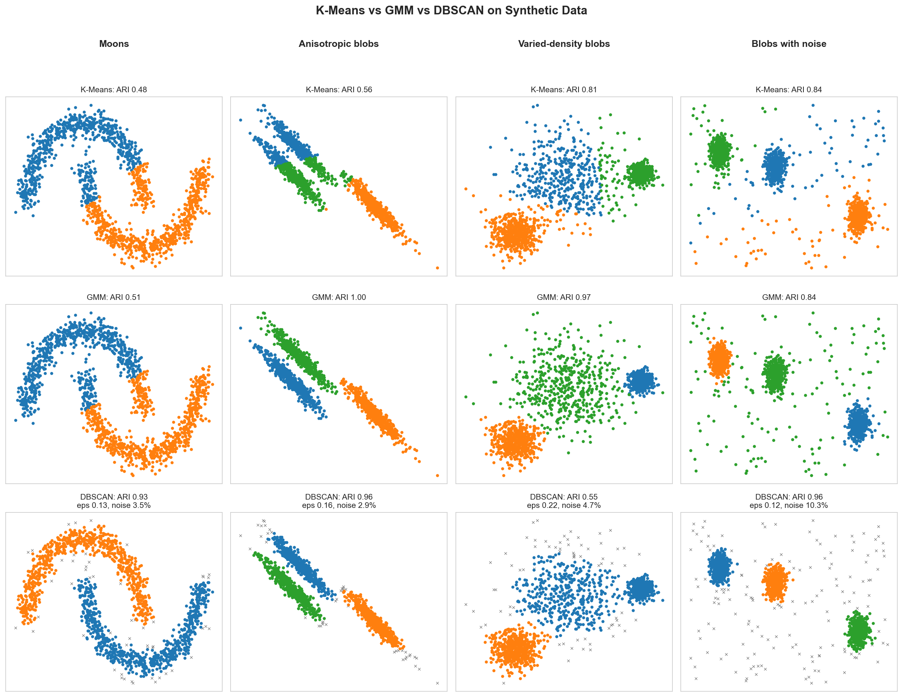
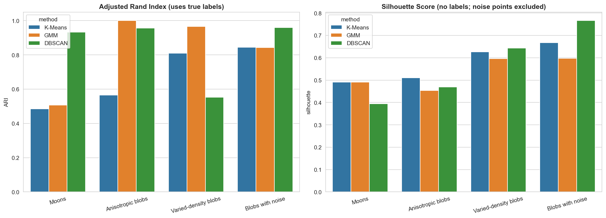
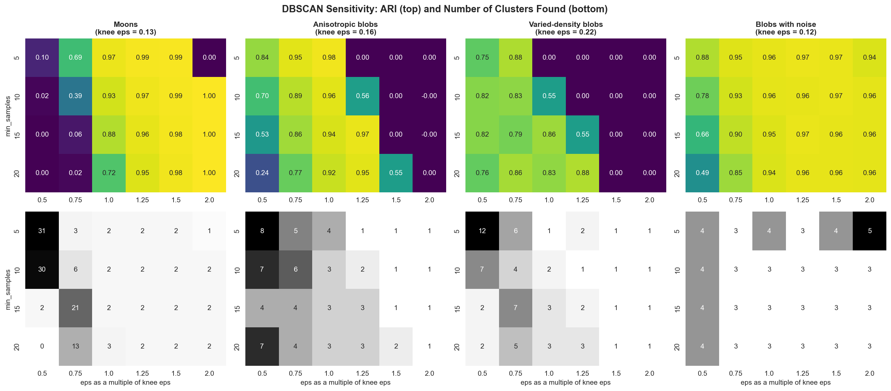
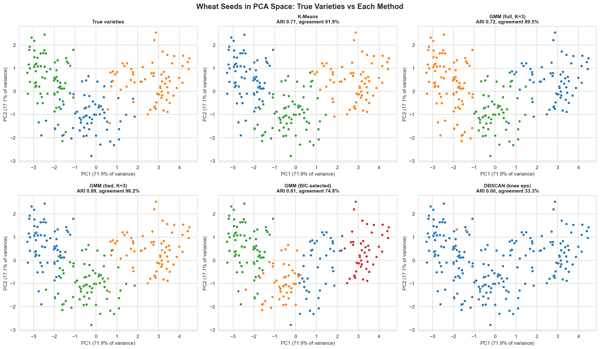
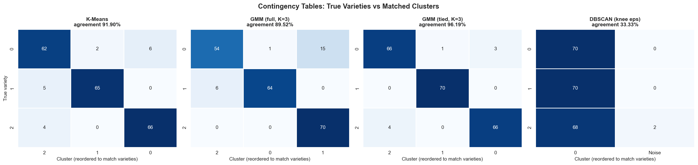

---

layout: default

title: Road Collisions (DBSCAN and Gaussian Mixture Models)

permalink: /dbscan-gaussian/

---

# This project is in development

## Goals and objectives:

The business objective is to show how density-based and model-based clustering can help a county highway authority decide where to concentrate a limited road-safety budget, and, just as importantly, to show when a simpler method such as K-Means is the wrong tool for the job.

A highway authority has a fixed annual budget for engineering interventions: junction redesign, speed management, signing and lining, anti-skid surfacing. It cannot investigate every location where a collision has been recorded, so it needs a short list of places to examine first. The data available is a year of police-reported injury collisions, each with a map location and a severity (fatal, serious or slight). This project uses the 3,896 collisions recorded in Kent in 2023 to find hotspots, and then asks whether those hotspots still concentrate collisions in 2024 (3,344 collisions), which is when the same authority would actually be spending the budget.

The [K-Means Clustering](/k-means-clustering/) project was previously the only clustering method in this portfolio, and collision locations are exactly the kind of data that stretches its assumptions. K-Means expects compact, roughly spherical clusters, forces every observation into a cluster, and needs K to be chosen in advance. Collisions cluster around junctions and along roads rather than in round blobs, many collisions are isolated events on quiet roads that belong to no hotspot at all, and there is no natural number of hotspots to specify. Two alternatives relax these assumptions in different ways:

* **Gaussian Mixture Models (GMM)** allow clusters of different sizes, elliptical shapes and orientations, and give each observation a probability of belonging to each cluster rather than a single hard assignment. They still assign every observation to a cluster and still need the number of components to be chosen.
* **DBSCAN** defines clusters as regions of high point density. It needs no K, finds clusters of arbitrary shape, and labels points in sparse regions as noise rather than forcing them into a cluster, but it relies on a single density threshold for the whole dataset.

The analysis is structured around three questions:

* **Where do each method's assumptions hold, and where do they fail?** A synthetic benchmark of four small datasets with known structure (interleaved crescents, stretched ellipses, clusters of very different density, and clusters buried in background noise) isolates what each method assumes, using the true labels to score each one. GMM and DBSCAN are then run on the Wheat Seeds data from the K-Means project, allowing a like-for-like comparison with its Adjusted Rand Index of 0.773 and its 91.90% agreement with the true varieties.
* **How are each method's parameters chosen without labels, and how far can those rules be trusted?** Real hotspot data has no true labels to tune against. The silhouette score (K-Means), BIC and AIC (GMM) and the k-distance curve with a sensitivity grid (DBSCAN) are each audited on the synthetic data, where the right answer is known, before being applied to the collision data.
* **Do the hotspots found in one year still capture collisions in the next, for the same amount of ground to investigate?** This is the question the highway authority actually cares about. It is answered with an out-of-time test: each method flags locations using 2023 data alone, every method is given the same area to flag, and the share of 2024 collisions falling inside the flagged ground is measured and compared with a practitioner benchmark (a simple grid of 500 m squares ranked by collision count). Bootstrap resampling quantifies how much of any difference could be chance, and the whole procedure is repeated on an earlier pair of years to check that the result is not specific to one year.

Two design choices follow from the [Data Science Workflow](/data-science-workflow/) page. First, the out-of-time success measure was agreed at the scoping stage, before any model was fitted to the collision data, to avoid selecting a metric after the fact that favours a preferred method. Second, because collision hotspots have no ground-truth labels, and because intrinsic scores such as the silhouette reward compact shapes rather than useful ones, the models are judged on held-out data from a later period. This mirrors the time-ordered splits that the Workflow page uses for time-dependent problems.

A decision-maker would use the results in three ways: to draw up a ranked short list of candidate sites for detailed collision-record review and site visits; to judge how much of the county's collision problem a hotspot approach can realistically cover for a given amount of ground; and to choose between methods on evidence about next year rather than on how tidy this year's clusters look.

The framing also raises questions that go beyond the model, and the [Ethics in Applied Data Science](/data-science-ethics/) page provides the context for them. A hotspot list directs scarce attention, so there is an accountability question about what happens to the places it leaves out: a collision labelled as noise is not a safe location, only an isolated one. Ranking sites by collision count and ranking them by the number of fatal and serious collisions can give different priorities, and choosing between them is a value judgement that should be made explicitly. A single density threshold may also favour dense urban areas over rural ones, which makes the geography of the results a fairness consideration in its own right. The project therefore examines where the hotspots fall, evaluates severity separately from volume, and reports its limitations, including a change in the severity mix of the data between years, alongside its positive findings.

As with the rest of this portfolio, the aim is not to produce an operational hotspot list or to achieve business-grade predictive performance. The effects measured here are modest, and the value of the project lies in the methodology: how to choose and defend a clustering method for spatial data, and how honestly to measure whether it worked.

## Application:  

Density-based and model-based clustering extend the idea behind K-Means, which is to find structure in unlabelled data, to settings where compact, equally sized clusters are an unrealistic assumption.

**Gaussian Mixture Models** treat the data as drawn from a mixture of several Gaussian (bell-shaped) distributions, each with its own centre, spread, shape and weight. The parameters are estimated iteratively using the Expectation-Maximisation algorithm, and each observation is then given a **probability of membership** in every component. This soft assignment is the main practical advantage over K-Means: observations sitting between two groups are reported as uncertain rather than being silently forced into one. The covariance type controls how flexible each component's shape is, from spherical (equivalent in spirit to K-Means) through to full, where every component has its own elliptical shape and orientation. The number of components is typically chosen using the **Bayesian Information Criterion (BIC)** or the Akaike Information Criterion (AIC), which reward fit but penalise complexity.

**DBSCAN** (Density-Based Spatial Clustering of Applications with Noise) works from a different principle. A point is a *core point* if at least `min_samples` points, including itself, lie within a distance `eps` of it. Clusters are built by linking core points that are within `eps` of one another, together with the border points that surround them, and any point that is reachable from no core point is labelled **noise**. There is no K to specify, clusters can take any shape, and outliers are handled naturally. The trade-offs are that a single `eps` must suit the whole dataset, so clusters of very different density are hard to find together, that results can be sensitive to the two parameters, and that the distance measure has to be meaningful for the data. In the [Anomaly Detection](/anomaly-detection/) project, Isolation Forest produces an anomaly score that is tuned against an explicit cost of missed and false alerts. DBSCAN's noise label is different in kind: it is a by-product of density rather than a score designed for the purpose, so it should not be read as an anomaly detector.

The three methods can be seen as a ladder of assumptions:

* **K-Means**: compact, similarly sized, spherical clusters; every point assigned; K chosen in advance.
* **GMM**: elliptical clusters of different sizes and orientations; soft memberships; every point still assigned; the number of components chosen in advance, typically by BIC.
* **DBSCAN**: clusters of any shape; no K; isolated points labelled as noise; one density threshold for the whole dataset.

No method is best in general. The right choice depends on which assumptions the data actually satisfies, and this is why the project tests each method on data where the truth is known before relying on it where it is not.

These techniques are used across many sectors, and the practical examples below show where they provide clear business value:

🚦 **Transport and Public Sector**:

**Road-safety hotspot identification**: Highway authorities cluster the locations of injury collisions to produce a short list of sites for engineering review, treating isolated collisions as noise rather than as hotspots.

**Infrastructure maintenance planning**: Councils group geocoded reports of potholes and road defects into dense clusters, so that repair crews can be scheduled by area rather than visiting reports one at a time.

**Public transport demand analysis**: Operators identify dense clusters of boarding points or journey origins from smartphone and ticketing data to inform stop placement and service frequency.

🏥 **Healthcare and Emergency Services**:

**Disease surveillance**: Public health teams cluster geocoded case reports to detect localised outbreaks, with sporadic isolated cases left as noise rather than inflating the apparent cluster.

**Emergency response planning**: Ambulance and fire services cluster historical call-out locations to decide where to position vehicles and crews, supporting shorter response times.

**Patient cohort discovery**: Analysts fit Gaussian Mixture Models to clinical measurements to identify overlapping patient subgroups, with soft membership probabilities reflecting that real patients do not always belong cleanly to one group.

🛍️ **Retail and Logistics**:

**Delivery zone design**: Logistics planners cluster delivery addresses into dense drop zones for route planning, handling remote one-off addresses separately instead of distorting the main zones.

**Footfall and site analysis**: Retailers analyse where customers dwell from anonymised location data to identify high-traffic zones for store placement and in-store layout.

**Customer segmentation**: Marketing teams use Gaussian Mixture Models to describe customer groups that overlap, using membership probabilities to weight offers rather than assigning each customer to a single segment.

🏦 **Finance and Insurance**:

**Claims geography after weather events**: Insurers cluster the locations of property claims following floods or storms to identify the affected areas, focus loss adjusters where claims are densest, and distinguish isolated claims from the event.

**Fraud ring detection**: Investigators look for dense groups of accounts or claims sharing unusual attributes, using density to surface coordinated activity while leaving unconnected cases out.

**Loss and risk modelling**: Actuaries fit mixtures of distributions to claim sizes, so that routine small claims and rarer large losses can be modelled as separate components rather than forced into one distribution.

## Methodology:  

### 1. Datasets

Three datasets are used, each for a different purpose.

* **Synthetic benchmark.** Four two-dimensional datasets of 1,500 points, generated with fixed seeds: interleaved crescents (moons), three stretched elliptical blobs (anisotropic), three blobs of very different spread (varied density), and three compact blobs with 150 uniformly scattered noise points (10%). The true labels, including which points are noise, are known, so each method can be scored directly.
* **Wheat Seeds.** The UCI Seeds dataset ([archive.ics.uci.edu/ml/datasets/seeds](https://archive.ics.uci.edu/ml/datasets/seeds)): 210 kernels, seven geometric measurements and three varieties of 70, exactly as used in the [K-Means Clustering](/k-means-clustering/) project. Features are standardised, and the labels are used only for evaluation.
* **Kent road collisions.** The Department for Transport road safety data (STATS19): police-reported injury collisions, published under the Open Government Licence v3.0 ([data.gov.uk](https://www.data.gov.uk/dataset/cb7ae6f0-4be6-4935-9277-47e5ce24a11f/road-accidents-safety-data)). Each record has an Ordnance Survey grid location in metres and a severity (fatal, serious or slight); **KSI** denotes fatal or serious. Kent (police force code 46) has 3,983 collisions in 2022, 3,896 in 2023 and 3,344 in 2024. No coordinates are missing in any year, and only 0.5% of 2023 collisions share an exact location with another.

### 2. Study area and data caveats

Police forces were screened for at least 3,000 collisions in each year and no more than 5% missing coordinates, which left seven. Kent was chosen because it combines a balanced urban and rural mix (51.6% urban) with a county-scale extent (4,209 km²). The Metropolitan Police area is 97% urban, leaving almost no rural background to treat as noise; West Midlands (94%) and West Yorkshire (81%) are also urban-dominated; and Police Scotland covers 88,084 km² with density that varies so widely that a single DBSCAN threshold would be expected to fit poorly.

Two caveats shape how results should be read. Only injury collisions reported to the police are recorded, so the data describes recorded collisions rather than all road risk. And the KSI share in Kent rose from 18.8% (2022) to 21.3% (2023) and 28.0% (2024) as serious collisions rose and slight collisions fell. The data cannot show why, and a change in recording practice is one possibility, so every severity result is measured against the test year's own KSI share.

### 3. Analytical approach

1. **Synthetic benchmark.** K-Means and GMM are given the true number of clusters, which is deliberately generous, so that any failure reflects a method's assumptions rather than a poor choice of K. DBSCAN uses `min_samples` = 10 and sets `eps` at the knee of the k-distance curve (each point's distance to its 10th nearest neighbour, sorted). Methods are scored with the Adjusted Rand Index (ARI), V-measure and silhouette, with DBSCAN's noise label treated as an extra group.
2. **Parameter selection without labels.** K-Means K is chosen from the elbow and silhouette (K = 2 to 8); GMM components (1 to 8) and covariance type (full, tied, diagonal, spherical) from BIC and AIC; DBSCAN `eps` from the knee, then a sensitivity grid of six `eps` multiples (0.5× to 2.0×) by four `min_samples` values. The labels are used here only to audit how reliable these rules are.
3. **Wheat Seeds bridge.** Preprocessing, seed and settings match the K-Means project, whose results are reproduced first. GMM is fitted at K = 3 for each covariance type and again with BIC-selected settings. DBSCAN uses `min_samples` = 14 (twice the number of features) with the knee `eps`, plus a grid search whose best case, which uses the labels, is reported as an upper bound. Agreement with the true varieties uses Hungarian matching, as on the K-Means page.
4. **Kent fit year (2023).** DBSCAN is fitted across nine `eps` values (100 to 1,000 m) and five `min_samples` values (5 to 20). Three DBSCAN tiers are then defined: **Site**, the setting that places the most collisions inside hotspots among those where no hotspot has a radius (centroid to furthest member) above 750 m; **Strict site** (200 m, 10); and **Area** (500 m, 10). K-Means and full-covariance GMM are fitted with as many clusters as the Site tier found, and again with K = 200.
5. **Out-of-time validation (2024).** Each method flags locations from 2023 data alone. A flagged zone is every location within 150 m of a collision in the flagged clusters, measured on a 25 m raster, with clusters flagged strongest first by collisions (or KSI collisions) per km² of footprint. Every method is given the same area: first the full area of the Site tier's zone, then 5% and 10% of the *collision-affected area* (everywhere within 150 m of any 2023 collision). The final cluster is flagged only as far as the budget allows, densest cells first. **Capture** is the share of all 2024 collisions inside the zone, **lift** compares it with random placement of the same area, and KSI capture and enrichment are reported separately. A grid of 500 m squares ranked by 2023 collision count is the practitioner benchmark. A paired bootstrap (1,000 resamples of the 2024 collisions) gives 95% intervals for each figure and for the difference between methods, and **retention** (the share of collisions inside the zone in 2024 divided by the share in 2023) measures regression to the mean.
6. **Replication.** The whole procedure, including re-selecting the Site tier, is repeated with 2022 as the fit year and 2023 as the test year.

### 4. Key methodological decisions

* **Coordinates in metres, unscaled.** Standardising would stretch the two axes unequally and make `eps` meaningless as a distance. In metres, `eps` has a physical meaning that can be reasoned about.
* **A size guard on hotspot radius.** An earlier guard limited the largest hotspot's share of all collisions, but a 243-collision conurbation with a 2.7 km radius passed it. A physical radius is the better test, because the authority investigates sites and road sections that an engineer can survey, not whole towns. The k-distance knee is reported for reference only, since a single global knee reflects the sparse rural roads rather than site-scale density.
* **Three DBSCAN scales.** Results depend on scale, so Site, Strict site and Area are all carried through validation rather than hiding the choice behind one setting.
* **Matched K, plus K = 200.** DBSCAN needs no K, so giving K-Means and GMM its cluster count is generous to them, and K = 200 tests whether a finer partition helps.
* **Equal area, not equal clusters.** The methods produce very different numbers and sizes of cluster, while area is what the authority actually spends investigating. The same footprint rule is applied to every method.
* **Out-of-time capture rather than silhouette.** The synthetic benchmark shows the silhouette rewarding compact shapes over correct structure, so hotspots are judged on whether they predict next year's collisions.
* **Ranking by density, and by severity separately.** Density measures how strongly collisions concentrate per unit of ground. Ranking by collision count and by KSI count can give different priorities, so both are reported.
* **A simple benchmark and explicit uncertainty.** Clustering must beat the simplest practitioner method to justify its added complexity, and the bootstrap prevents small differences being over-read.

All random processes use fixed seeds, so every figure reproduces exactly, and the full analysis runs on a CPU-only laptop in a few minutes.

## Results:

**Synthetic Benchmark: Where Each Method's Assumptions Hold and Fail**

K-Means and GMM were given the true number of clusters on each dataset, so the differences below reflect assumptions about shape, density and noise rather than a poor choice of K.

| Dataset | K-Means ARI (silhouette) | GMM ARI (silhouette) | DBSCAN ARI (silhouette) | DBSCAN noise |
|---|---|---|---|---|
| Moons | 0.48 (0.49) | 0.51 (0.49) | **0.93** (0.39) | 3.5% |
| Anisotropic blobs | 0.56 (0.51) | **1.00** (0.45) | 0.96 (0.47) | 2.9% |
| Varied-density blobs | 0.81 (0.63) | **0.97** (0.60) | 0.55 (0.64) | 4.7% |
| Blobs with noise | 0.84 (0.67) | 0.84 (0.60) | **0.96** (0.77) | 10.3% |

_Figure 1: Each method on each dataset (02_synthetic_method_comparison.png)._ Each method wins where its assumptions hold and fails where they do not.

* **Moons.** K-Means and GMM cut each crescent into compact halves (ARI 0.48 and 0.51), while DBSCAN follows the crescents (ARI 0.93), labelling 3.5% of points on their edges as noise.
* **Anisotropic blobs.** K-Means, which implicitly assumes equal spherical variance, mixes the stretched clusters (ARI 0.56). GMM's full covariance recovers them exactly (ARI 1.00), and DBSCAN comes close (0.96).
* **Varied-density blobs.** GMM is best (0.97) and K-Means reasonable (0.81). DBSCAN finds only two clusters (ARI 0.55), merging the diffuse cluster with a neighbouring tight one, because no single `eps` suits both densities.
* **Blobs with noise.** K-Means and GMM must place every point in a cluster, and both reach 0.84. DBSCAN reaches 0.96 and labels 10.3% of points as noise against a true 10%.

_Figure 2: Adjusted Rand Index (left) beside silhouette score (right) (03_synthetic_ari_vs_silhouette.png)._ The silhouette, which needs no labels, often ranks methods in the opposite order to the truth. On the moons it prefers K-Means and GMM (0.49) to DBSCAN (0.39) although DBSCAN recovers the structure and they do not. On the anisotropic blobs it gives K-Means the highest score (0.51) and GMM, which is perfect, the lowest (0.45). On the varied-density blobs DBSCAN scores highest (0.64) while merging two clusters. The silhouette for DBSCAN also excludes noise points, which flatters it on the noisy dataset (0.77). Intrinsic scores reward compact shapes, which is why the collision analysis later is judged on out-of-time performance instead.

**Choosing Parameters Without Labels**

Real hotspot data has no true labels, so each method's selection rule was tested where the truth is known.

| Dataset | True K | K-Means K (silhouette) | GMM by BIC (components, covariance) | DBSCAN settings with ARI ≥ 0.8 |
|---|---|---|---|---|
| Moons | 2 | 2 | 8, full | 14 of 24 (58.3%) |
| Anisotropic blobs | 3 | 2 | 3, tied | 10 of 24 (41.7%) |
| Varied-density blobs | 3 | 3 | 3, diagonal | 8 of 24 (33.3%) |
| Blobs with noise | 3 | 2 | 5, diagonal | 21 of 24 (87.5%) |

* **K-Means (silhouette).** The maximum silhouette recovers the true K on two of four datasets and picks K = 2 on the anisotropic and noisy blobs, where the truth is 3.
* **GMM (BIC).** BIC recovers three components on the anisotropic and varied-density blobs and correctly chooses tied covariance for the anisotropic blobs, which share one covariance because a single linear transform created them. On the moons it chooses eight components to tile the crescents with Gaussians, and on the noisy blobs five (AIC chooses seven), because extra components absorb the background noise. BIC counts Gaussians, not natural clusters.
* **DBSCAN (k-distance knee).** The knee `eps` (0.13, 0.16, 0.21 and 0.12 in standardised units) recovers the structure on three of the four datasets (ARI 0.93 to 0.96) and fails on the varied-density blobs (0.55).

_Figure 3: DBSCAN's ARI (top) and number of clusters found (bottom) across `eps` multiples and `min_samples` (07_dbscan_sensitivity.png)._ The result depends heavily on the settings. On the moons it is largely stable at and above the knee `eps` (ARI 0.72 to 1.00 for `min_samples` of 10 or more) but fragments into around 30 clusters at half the knee value with `min_samples` of 5 or 10. On the anisotropic blobs it collapses to one or two clusters at 1.5 times the knee value or more. On the noisy blobs it holds across almost the whole grid. On the varied-density blobs only some of the larger `min_samples` settings (15 to 20) recover three clusters (ARI 0.83 to 0.88), and a label-free rule would not reveal which. No selection rule is reliable enough to be trusted blindly, which is why the Kent analysis reports results across a range of `eps` values.

**Wheat Seeds: Comparison with the K-Means Project**

The same preprocessing, seed and settings as the [K-Means Clustering](/k-means-clustering/) project reproduce its results exactly: ARI 0.773, silhouette 0.40 and 91.90% matched agreement with the true varieties.

| Method | Clusters | ARI | Matched agreement | Silhouette |
|---|---|---|---|---|
| K-Means (K = 3) | 3 | 0.773 | 91.90% | 0.40 |
| GMM, full covariance (K = 3) | 3 | 0.723 | 89.52% | 0.36 |
| GMM, **tied** covariance (K = 3) | 3 | **0.890** | **96.19%** | 0.38 |
| GMM, diagonal covariance (K = 3) | 3 | 0.679 | 87.62% | 0.37 |
| GMM, spherical covariance (K = 3) | 3 | 0.758 | 91.43% | 0.40 |
| GMM selected by BIC (full, K = 4) | 4 | 0.610 | 74.76% | 0.28 |
| DBSCAN at the knee `eps` (1.51, `min_samples` 14) | 1 | 0.000 | 33.33% | not defined |
| DBSCAN, best of the grid (uses the labels) | 2 | 0.388 | 56.19% | 0.47 |

_Figure 4: The seeds in the first two principal components (89.0% of variance) coloured by true variety and by each method (08_wheat_pca_comparison.png)._ The varieties overlap, with no visible gaps between them.

_Figure 5: Contingency tables of true variety against matched cluster for K-Means, two GMMs and DBSCAN (09_wheat_contingency_tables.png)._ K-Means places 193 of 210 seeds correctly. GMM with tied covariance places 202, recovering one variety perfectly (70 of 70) and misassigning eight seeds. GMM with full covariance places 188. DBSCAN puts 208 seeds in a single cluster and labels two as noise.

* **GMM helps only with the right covariance structure.** Tied covariance, one shared shape for all three varieties, raises agreement from 91.90% to 96.19% over K-Means. Full covariance does worse (89.52%), because it estimates 28 covariance parameters per component from only 70 seeds each. This fits the varieties differing mainly in position and size rather than in shape.
* **Label-free selection chose the wrong model.** BIC selects full covariance with four components (74.76% agreement), rewarding likelihood fit rather than recovery of the varieties, as it did on the synthetic moons and noisy blobs.
* **DBSCAN fails here, as its assumptions predict.** At the knee `eps` it finds a single cluster, and even the best grid setting, chosen using the labels, reaches only 56.19%. The varieties overlap with no low-density gaps to separate them, which makes this a useful example of when not to use DBSCAN.
* **Intrinsic scores barely separate the methods.** Silhouette values for the three-cluster models range only from 0.36 to 0.40, while agreement with the true varieties ranges from 87.62% to 96.19%.

## Conclusions:

Conclusions from the project findings and results.

## Next steps:  

Next steps based on current results and conclusions from above and suggested follow-up actions, analysis etc.

## Python code:
You can view the full Python script used for the analysis here: 
[View the Python Script](/dbscan_gmm_final_script.py)
