---

layout: default

title: Electricity Demand Forecasting (Prophet)

permalink: /seasonal-forecasting/

---

## Goals and objectives:
  
The business objective is to determine how accurately an energy retailer's procurement team can forecast daily electricity demand 90 and 365 days ahead, the horizons over which forward power purchases are planned, and how large a buffer it should hold against the forecast error that remains. A retailer that buys forward exactly the forecast volume is exposed when demand exceeds it, while over-buying creates surplus volume, so forecast accuracy translates directly into a procurement and risk-management decision.  
  
The project addresses three questions:
- How accurately can daily electricity demand be forecast 90 days and one year ahead, and what level of procurement buffer is implied by the remaining error?
- Does **Prophet's** explicit treatment of trend changes, weekly and annual seasonality and public holidays improve forecasts compared with classical alternatives?
- Do external regressors, specifically wind and solar generation, provide enough additional forecasting value to justify acquiring and maintaining them?
  
The analysis uses the Open Power System Data (OPSD) daily German electricity series: 4,383 days of national consumption from 1 January 2006 to 31 December 2017, with wind generation available from 2010 and solar generation from 2012. The retailer's own demand is assumed to be proportional to national consumption. The first ten years (2006 to 2015) are used for exploration, model development and tuning, while the final two years (2016 to 2017) form a 731-day chronological holdout. Model selection uses walk-forward cross-validation within the training period so that future observations are not used to choose the primary forecasting model.
  
Three classical baselines, a **seasonal naive forecast**, a weekly **SARIMA**, and a **SARIMAX** with annual Fourier terms, holiday indicators and a level-step indicator, are compared with Prophet. Prophet's configuration is selected by walk-forward cross-validation, and model differences are assessed using a paired block bootstrap. A controlled experiment then tests whether wind and solar generation add forecasting value, using matched baselines and placebo regressors to distinguish small improvements from noise. Finally, Prophet is applied to the same Air Passengers data and train/test split used in the [ARIMA](/arima/) project, providing a like-for-like comparison between the two techniques.
  
The primary tuned Prophet achieves a MAPE of 2.30% and an MAE of 31.5 GWh/day on the 731 held-out days, compared with 3.02% and 41.9 GWh/day for SARIMAX and 3.50% and 47.0 GWh/day for the seasonal naive forecast. Across the harder walk-forward validation, Prophet's MAPE is 3.26% over the first 90 days and 4.18% over a full year; these folds include the effects of the 2013/14 level shift that could not have been known in advance. Wind and solar generation produce no detectable improvement once compared with matched baselines and placebo regressors. On the Air Passengers series, tuned Prophet (MAE 16.2 thousand passengers) and the optimal ARIMA model (14.9) cannot be distinguished on the available test data.
  
As elsewhere in this portfolio, the purpose is not to claim business-grade forecasting accuracy from a public dataset. It is to demonstrate a rigorous forecasting workflow in which models are evaluated on unseen future observations, competing approaches are compared on equal terms, uncertainty around model differences is quantified, and unexpected or null results are reported rather than discarded.

## Application:  

Prophet is an open-source forecasting procedure developed by Meta's Core Data Science team (Taylor and Letham, 2018). It fits an additive regression model, or a multiplicative one where seasonal swings grow with the level of the series, built from three components: a piecewise-linear trend whose slope is allowed to change at automatically selected changepoints; seasonal patterns of any period, represented as Fourier series (here weekly and annual); and holiday effects specified through an analyst-supplied calendar. External regressors can be added, the model is fitted by optimisation in Stan (computational engine), and prediction intervals are simulated from the uncertainty in the trend. This structure suits series dominated by calendar effects, with strong weekly and annual cycles, public holidays and occasional trend changes. Its practical benefits are interpretability and control: each component can be plotted and explained to a non-technical stakeholder, missing observations are tolerated, and a domain expert can supply knowledge directly (a holiday calendar, a known level shift) instead of relying on the optimiser to discover it. Its limitation, visible in this project's residual diagnostics, is that it does not model short-run autocorrelation.  

In this project, the remaining short-run autocorrelation makes Prophet better suited to the medium- and long-horizon planning problem than to next-day forecasting unless an additional short-term component is introduced.

The business application of Prophet spans any domain where demand follows a calendar:

⚡ **Energy and utilities:**

**Forward procurement and demand forecasting**: as demonstrated in this project, retailers and traders forecast daily demand months ahead to set forward purchase volumes and hedging positions, where the weekly and annual cycles and holiday effects that Prophet isolates (a fall of 27 to 28% on Christmas Day) translate directly into volume decisions.  
**Grid and capacity planning**: system operators use long-horizon demand forecasts to plan generation capacity, maintenance windows and reserve margins, where an interpretable decomposition into trend and seasonality helps explain to regulators and planners why forecast peak demand is rising or falling.

🏥 **Healthcare:**

**Emergency department attendance and bed occupancy**: hospitals forecast daily attendances, which follow weekly rhythms, winter pressures and bank-holiday effects, to set staffing rosters and bed capacity weeks in advance.  
**Pharmacy and clinical supply demand**: seasonal illness and holiday opening patterns shape demand for medicines and consumables, and forecasts that reflect those calendars reduce both stock-outs and waste.

🚆 **Transport and logistics**:

**Passenger demand and capacity planning**: rail, bus and airline operators forecast ridership with commuting patterns by day of week, school-holiday peaks and public-holiday troughs, the same structure as the Air Passengers series revisited in this project, to schedule services and set fares.  
**Parcel and freight volumes**: courier and logistics networks forecast daily volumes with sharp annual peaks, such as the run-up to Christmas, to plan vehicles, depot capacity and temporary staffing.

🏨 **Hospitality and leisure**:

**Occupancy and booking demand**: hotels forecast daily occupancy, shaped by weekends, school holidays and local events, which Prophet accommodates through custom holiday windows, to inform pricing and staffing.  
**Visitor numbers for venues and attractions**: operators forecast footfall driven by weekends, holiday periods and the annual season to plan opening hours, staffing and capacity, where an explicit holiday calendar captures the days on which normal patterns break.

## Methodology:  

The analysis is implemented in Python using pandas and NumPy for data handling, Prophet for the core forecasting models, statsmodels for the SARIMA, SARIMAX and ARIMA models and the residual diagnostics, SciPy for the Box-Cox transformation, the holidays package for the German public-holiday calendar, and seaborn and matplotlib for visualisation. The primary dataset is the Open Power System Data (OPSD) daily German electricity series, obtained from [github.com/jenfly/opsd](https://github.com/jenfly/opsd) (file opsd_germany_daily.csv), a daily extract of the OPSD time series data package published at [open-power-system-data.org](https://open-power-system-data.org/), which draws on the German transmission system operators and the ENTSO-E data portal. It contains 4,383 consecutive daily observations from 1 January 2006 to 31 December 2017 in four columns, all in GWh per day: Consumption (national electricity consumption), Wind and Solar (generation) and Wind+Solar (their sum). Consumption is complete. Wind generation starts on 1 January 2010 and solar generation on 1 January 2012, with 2 and 4 isolated missing days respectively after those dates. A second dataset, the Air Passengers series used in the [ARIMA](/arima/) project, supports the bridge analysis described at the end of this section.

The workflow has seven stages:
1. Validate the data.
2. Split it chronologically into training and test periods.
3. Explore the training years, with each finding tied to a modelling decision.
4. Fit three classical baselines.
5. Fit Prophet, with hyperparameters tuned by walk-forward cross-validation.
6. Evaluate every model on the held-out test years and quantify how far the differences between models can be trusted.
7. Run a controlled experiment on wind and solar generation, then repeat the Prophet versus ARIMA comparison on the Air Passengers series.

### Data Validation

Forecasting models fail quietly on faulty inputs: a duplicated or missing date shifts every seasonal pattern that follows it, so the data is validated before any modelling. Structural checks are treated as hard failures that stop the script: the expected columns must be present, with no duplicated dates, no gaps in the daily calendar and no non-positive consumption values. All passed. Softer findings are reported rather than treated as errors: the availability windows and gap days of the wind and solar series, which matter because Prophet cannot accept a missing value in a regressor; a consistency check that Wind+Solar equals Wind plus Solar wherever all three are present (maximum discrepancy 0.0000); and a plausibility screen on the five lowest-consumption days, all of which fall in 2009, four of them Easter or Whit holidays. In a production setting these checks would sit in a formal validation suite of the kind built in the [Great Expectations](/great-expectations/) project.

### Chronological Train/Test Split

The first ten years (2006 to 2015, 3,652 days) are used for training and tuning, and the final two (2016 to 2017, 731 days) are held out for testing. A random split would be wrong for a time series, because the model would train on days on either side of the ones it is tested on and overstate its accuracy. Two test years were chosen rather than one because they contain two complete annual cycles, a more reliable verdict than a single year of weather and calendar. The split is made before exploratory analysis, so that no decision about seasonality, holidays or regressors can be influenced by the test years: the exploratory stage uses the training years only, and the test set is first used only after the primary forecasting models and their selection rules have been fully specified. Subsequent analyses prompted by test-set diagnostics are explicitly labelled as sensitivity analyses or experiments and are not used to replace the primary model.

Within the training period, the wind and solar series define two shorter windows: 2,189 days with wind (2010 to 2015) and 1,456 days with both wind and solar (2012 to 2015), after dropping the few days with a missing value.

### Exploratory Analysis and the Decisions It Drove

Exploratory analysis here has a methodological purpose: each finding determines a specific modelling decision.

* **Level shifts**. Seasonality dominates a daily electricity series, so level changes are hard to see in the raw data. Each day is therefore compared with the same weekday 52 weeks earlier (a 364-day lag keeps the weekday aligned), which removes the seasonal pattern, so that a one-off step appears as a plateau of year-on-year change lasting about a year. Every stretch in which this change stays beyond ±5% for at least 45 days is listed, and the onset of the main step is located using regular days only, because the Christmas period distorts the comparison. This identified a persistent step of about +8.7% between 23 December 2013 and 14 January 2014, and a temporary shortfall of about 9% between May and October 2009. A candidate explanation for the step is a change in the source's coverage: the OPSD documentation describes a representativity factor for German load of 91% until 2014 and 97% since, which alone would lift reported values by about 6.6%. This is not confirmed, so the step is handled explicitly in the models, and the 2009 shortfall is carried through a sensitivity analysis (below) instead of being silently removed.
* **Seasonal profiles**. Each day is expressed relative to the mean of its own calendar year, which removes year-to-year level differences (including the step) so that only the seasonal shape remains, using regular days only.
* **Holiday effects**. The effect of a holiday is measured against what an ordinary day of the same weekday would have used, taken as the mean of the same weekday one to four weeks either side, using regular days only. This local baseline is unaffected by seasonality and by the level step. Easter Sunday and Whit Sunday are absent from the national holiday list but show clear dips against an ordinary Sunday, so they are added to the holiday calendar, and the Christmas to New Year period is split into groups of days with similar dips.
* **Additive or multiplicative seasonality**. The size of the weekly and annual swings is measured year by year and compared with the year's level. With only ten annual points the evidence is weak and mixed, so the choice is left to cross-validation.
* **Wind and solar**. Raw correlations with consumption mislead: solar peaks in summer, when demand is lowest, and both series grow with installed capacity rather than with demand. Each series and consumption are therefore first stripped of year level, weekday pattern and annual cycle (four pairs of Fourier terms), and the leftover residuals are correlated.

### Baseline Models

Three baselines of increasing sophistication are fitted, so that Prophet is compared with the best classical alternative and not with a straw man. All three forecast the full 731 test days from a single origin at the end of 2015, just as the ARIMA project forecast its 29-month holdout.
* **Seasonal naive (M0a)**. Each test day is forecast with the value from the same weekday in the most recent observed year. A 364-day lag keeps weekdays aligned; for the second forecast year the lag is 728 days, because 364 days back would fall inside the unknown test period.
* **SARIMA (M0b)**. SARIMA(1,0,1)(0,1,1) combines short-term dynamics with a seasonally differenced component for the weekly cycle. By design it has no annual cycle, no holidays and no handling of the level step: it shows what a standard single-period seasonal model achieves over a two-year horizon.
* **SARIMAX (M0c)**. The same structure with regressors added: four pairs of annual Fourier terms (sine and cosine waves at the annual frequency and its first three harmonics, the standard way to represent a long seasonal cycle in an ARIMA-family model), a holiday indicator, a Christmas to New Year indicator and the level-step indicator. It therefore receives the same calendar information as Prophet, so any difference in results reflects the model and not the inputs. All of its regressors are deterministic calendar quantities, known at forecast time. SARIMAX is not covered elsewhere in this portfolio.

### Prophet Model Specification

Prophet decomposes the series into trend, seasonal, holiday and regressor components (see Application). The configuration used here has six elements.
* **Trend**. Piecewise linear, with 25 candidate changepoints placed uniformly over the first _changepoint_range_ share of the history. A sparse (Laplace) prior, whose scale _changepoint_prior_scale_ controls how freely the slope may change, keeps most changepoints close to zero unless the data demand otherwise.
* **Seasonality**. Weekly and annual, with the annual Fourier order and the additive or multiplicative mode tuned. Daily seasonality is switched off because it is meaningless for daily data.
* **Holidays**. A table of 18 named holidays (288 dated rows): the nine national holidays, Easter Sunday and Whit Sunday, Reformationstag (a one-off national holiday on 31 October 2017, which falls in the test period only, so no effect can be learned for it.  It is retained in the calendar for completeness, but because no occurrence exists in the training data its inclusion cannot provide a learned holiday adjustment for the 2017 occurrence.), and six groups covering the Christmas to New Year period: Vor_Weihnachten (22 and 23 December), Heiligabend (24 December), Zwischen_den_Jahren (27 to 30 December), Silvester (31 December), Nach_Neujahr (2 and 3 January) and Anfang_Januar (4 to 6 January). Where two holidays coincide the first name is used, so their effects are not added together. Only national holidays are used, because regional holidays, which differ by federal state, cannot be separated in a national series; this is a stated limitation.
* **Level-step regressor**. A binary indicator equal to 0 before 1 January 2014 and 1 afterwards, the year boundary lying inside the step window found in the exploratory analysis. Whether to offer it to Prophet is itself tested by cross-validation.
* **Uncertainty**. 95% prediction intervals from 1,000 simulated draws, matching the interval width used in the ARIMA project.
* **Estimation**. Maximum a posteriori optimisation, which is fast on a CPU and reproducible for a fixed random seed.

### Hyperparameter Tuning by Walk-Forward Cross-Validation

Prediction is only credible if the tuning that precedes it is, so hyperparameters are chosen by walk-forward cross-validation inside the training years only. Each fold fits a model on all data up to a forecast origin and forecasts the following 365 days, imitating the real task of forecasting a year ahead from "today", at nine different values of "today": origins 180 days apart, from 21 January 2011 to 31 December 2014, each with at least five years of history. No model ever sees data after its origin. Folds with origins before 2014 cannot see the level step in their history while their forecast year contains it, so every model fails on it alike; per-fold results are therefore reported alongside the average.
The search covers every combination of four choices, 36 configurations in total, with the annual Fourier order held at Prophet's default of 10:

* _changepoint_prior_scale_ in {0.01, 0.05, 0.2}, from a stiff to a flexible trend;
* _changepoint_range_ in {0.8, 0.9, 0.95}, because the step lies about 85% of the way through the history, beyond the default of 0.8;
* seasonality mode, additive or multiplicative;
* whether the level-step regressor is offered or Prophet must cope with the step through its trend alone.

A second pass then varies the annual Fourier order (6 and 15) around the best configuration, a greedy search that keeps the run time reasonable, giving 38 configurations in all. The configuration with the lowest MAPE averaged over all nine folds is selected. This rule was fixed before the test set was touched. An out-of-the-box Prophet (default settings and Prophet's built-in German holiday list) is also fitted as a reference, to show how much the tailored configuration adds.

### Evaluation

Each model is evaluated on the 731 held-out days using the same four headline metrics as the ARIMA project: MAE, RMSE, MAPE (the mean absolute error as a percentage of the actual value) and R² (one minus the ratio of the residual to the total sum of squares on the test set). Bias (forecast minus actual, so positive means over-forecasting) and the empirical coverage and mean width of the 95% prediction intervals are reported alongside them. Four further views answer the business question more directly:
* **Horizon**. Errors are reported for horizon bands of 1 to 90, 91 to 365 and 366 to 731 days after the forecast origin. Because all bands come from a single origin, horizon is confounded with season (the first band is always January to March), so the bands are descriptive only. The cross-validated error by horizon, drawn from nine origins at different times of year, is the sounder evidence on how error grows with horizon.
* **Holidays**. Error on holidays and Christmas to New Year days (45 of the 731 test days) is reported separately from ordinary days, since this is where calendar handling is tested.
* **Procurement buffer**. A retailer that buys forward exactly the forecast volume is short on any day when demand exceeds it. The buffer is the 95th percentile of that shortfall, as a percentage of the forecast and in GWh/day: hold this much extra volume and demand exceeds the hedged amount on only one day in twenty. The risk is two-sided, because a model that over-forecasts needs a small buffer but leaves the retailer holding surplus volume, so the 95th percentile of over-forecast is reported beside it and the two are read together.
* **Residual diagnostics**. In-sample residuals are examined with the Ljung-Box test at lags 7, 14 and 28 and an autocorrelation plot. The ARIMA project's residuals were close to white noise; Prophet has no mechanism for day-to-day dependence, so autocorrelated residuals are expected and reported as a limitation.

### Quantifying Uncertainty in Model Comparisons: The Paired Block Bootstrap

A lower MAE on one test set is not proof that one model is better: the 731 test days are a single sample of weather and calendar luck. The paired block bootstrap asks how much the difference in MAE between two models would vary if the test period could be redrawn. For each pair of models, the daily difference in absolute error is calculated (model A's absolute error minus model B's, so negative values favour A). The 731 differences are then resampled thousands of times to build a distribution of the average difference, and the 2.5th and 97.5th percentiles give a 95% interval. Two details matter. The comparison is paired, meaning both models are judged on the same days, which removes the day-to-day difficulty that affects both models alike. And the resampling is by block: whole stretches of 28 consecutive days are drawn together, because forecast errors on neighbouring days are strongly correlated, and resampling single days would make the interval far too narrow. The script uses 2,000 resamples, and also reports the share of resamples in which model A is better. An interval that excludes zero indicates a difference unlikely to be test-sample luck; an interval spanning zero means the two models cannot be distinguished on this evidence.

### Sensitivity Analyses

Two checks measure the influence of analyst choices rather than assuming it. First, the April to September 2009 shortfall is left in the primary model and also masked in a variant (183 days set to missing, which Prophet ignores), so its effect on the forecast is measured. Second, M1 was chosen by mean MAPE over all nine folds, but the two latest folds are the only ones able to show whether a configuration copes with the level step, and they favour a different configuration. That alternative is fitted as a clearly labelled sensitivity model; it is not a replacement for M1, because switching the selection rule after seeing test results would be a forking path.

### The Wind and Solar Regressor Experiment

**Why wind and solar are kept out of the core model**. Prophet regressors must have known values at forecast time. A forecast made at the end of 2015 for 2016 and 2017 cannot know actual wind and solar output for those dates, so a model that uses them is no longer a genuine forecast. The physical link is also indirect (generation is not demand; both act as weak proxies for weather), both series grow with installed capacity rather than with demand, and using them shortens the training window to the years in which they exist. The experiment therefore asks a different question: even if their future values were supplied perfectly, would they improve the forecast? Any gain found is an upper bound on what a real forecaster could achieve.

**Design**. Each regressor model is compared with a matched baseline: the same Prophet without regressors, trained on exactly the same shorter window. M2 adds wind (trained 2010 to 2015); M2b adds wind (2012 to 2015); and M3 adds wind and solar (2012 to 2015). The matched baselines are M1-W10 (no regressors, 2010 to 2015) and M1-W12 (no regressors, 2012 to 2015). All models keep the hyperparameters of the configuration under test, so the only thing that differs between a model and its baseline is the regressor. Prophet standardises each regressor, so its learned coefficient is the effect of a one-standard-deviation rise, reported as a percentage of consumption. Two hypotheses were recorded in the script before the experiment was run: H1, that wind and solar add no forecasting value beyond trend, seasonality and calendar effects, so each regressor model matches its baseline within the noise floor described next; and H2, that shortening the training window to use them costs more accuracy than they could win back.

**Placebo regressors: establishing a noise floor**. A change in test MAE of a few tenths of a GWh after adding wind is hard to interpret on its own. It might be a genuine gain, or it might be noise, because refitting a flexible model with any extra column nudges its trend and seasonal estimates slightly. The question "did wind help?" therefore needs a yardstick: how much does the error change when a regressor that cannot contain real information about demand is added in exactly the same way? Placebo regressors provide it, borrowing their logic from permutation tests in statistics and placebo tests in causal inference. One placebo _draw_ works as follows:

1. Take the real wind series and rotate it circularly by a random number of days, at least 180 days away from its true alignment, so that the value recorded for one date is now attached to a different date. The few missing days are filled by interpolation for this purpose only.
2. The rotated series keeps everything about wind except its timing relative to demand: the same distribution, seasonal shape, day-to-day persistence and capacity growth. Rotation is used rather than random shuffling because shuffling would destroy the persistence in wind, and a smooth real series might then look special merely for being smooth.
3. Refit the model with the rotated series in place of the real one (for the wind-and-solar model, an independently rotated solar series too), on the same training window, forecast the same 731 test days, and record the change in test MAE against the matched baseline.
4. Repeat for 10 draws for each of the three model types, 30 refits per run.

The spread of changes across the draws (lowest, median and highest) is the _placebo range_: what a regressor known to be useless produces by chance. The real regressor is judged against it. If the real change lies inside the placebo range, the model has not found usable signal; if it is clearly better than every placebo, that is evidence of real information. A summary figure, "placebos at least as good", reports the share of draws that did at least as well as the real regressor. Because there are 10 draws, it moves in steps of 10%, which is coarse: even a real result better than every placebo would arise by chance roughly one time in eleven, so such a result is suggestive rather than conclusive. The same comparison is made for the learned coefficients, setting the effect of a one-standard-deviation rise in the real series against the same quantity for each placebo series. The placebo draws use the same random seed in every run, so runs are directly comparable.

_Stability screen and the two reruns_. The first run of this experiment used the hyperparameters tuned for M1 on every window, and the four-year (2012 to 2015) models performed far worse than M1. The cause was not the regressors. Prophet extrapolates the slope of its trend at the end of the history: with the flexible trend tuned for ten years of data (_changepoint_prior_scale_ 0.2) and a fixed _changepoint_range_ of 0.8, a four-year window allows the slope to change in the final nine months, and the model then projects whatever slope it ended on across two years of forecast. To make this visible and stop it contaminating the conclusions, the script reports each model's trend drift (the change in the fitted trend across the 731 test days, per year) and treats a drift of more than 1.5% of average consumption per year, about ±20 GWh/year, as unstable. The hypotheses are judged only on comparisons in which both models are stable. Two reruns then isolated the cause, each changing one thing:

* **Conservative trend**: _changepoint_prior_scale_ reduced from 0.2 to 0.05, so the trend bends less.
* **Matched changepoint range**: _changepoint_range_ set for each window so that the last 730 days before the forecast origin carry no changepoints, as they do for M1. This gives 0.80 for the ten-year window, about 0.67 for six years and 0.50 for four.

The conclusions about wind and solar rest on the run in which all models pass the stability screen. The other runs are reported as a record of the failure and its diagnosis.

_A direct check on forecast errors_. As an independent second look, M1's out-of-sample forecast errors on the test period are correlated with wind and solar after removing year level, weekday pattern and annual cycle (the same adjustment as in the exploratory analysis). If the regressors carried information the core model lacks, its errors would be related to them. The interval for these correlations is optimistic, because daily residuals are autocorrelated.

### Air Passengers Bridge

The ARIMA project's Next Steps proposed benchmarking Prophet on the same split, so the final stage repeats its forecast. The same 144 monthly observations (January 1949 to December 1960) are split 80/20 chronologically, giving 115 training months and a 29-month test set, computed exactly as in that project. Its two ARIMA models, ARIMA(12,1,12) on the raw series and ARIMA(12,2,12) on Box-Cox-transformed data with lambda estimated on the training data only, are refitted here. This confirms that the data and split match (the re-run reproduces the published metrics) and puts both techniques through the same software. ARIMA(12,2,12) has 24 parameters for 115 observations and the optimiser does not fully converge, so its results can move slightly between software environments.

Four Prophet variants map onto the ARIMA project's story. Additive seasonality at default settings is the counterpart of the untransformed ARIMA baseline. Multiplicative seasonality at default settings is Prophet's own answer to seasonal swings that grow with the series. The same Box-Cox transformation followed by additive Prophet is the like-for-like counterpart of the optimal ARIMA. A tuned variant is chosen by the same walk-forward approach as before: 24 configurations (seasonality mode, _changepoint_prior_scale_ in {0.01, 0.05, 0.1, 0.5}, annual Fourier order in {3, 6, 10}) over seven rolling origins, each forecasting 29 months ahead from at least 48 months of history. Weekly and daily seasonality are off for monthly data. Accuracy is measured with the ARIMA project's metrics, and because 29 test months give very little statistical power, differences are assessed with the same paired block bootstrap, using three-month blocks.

### Reproducibility and Safeguards

Every model is fitted on a CPU-only laptop. The random seed is fixed, Prophet's interval sampling is reseeded for each model, and the cross-validation results are cached, so the first run takes tens of minutes (almost all in the several hundred Prophet fits of the tuning stage) and later runs take a few minutes. Results reproduced to about 0.1 GWh/day between two different machines for the stable models, while the unstable four-year models differed by a few GWh/day, itself a symptom of that instability.

Four safeguards limit the risk of fooling ourselves. The test set is first used only after every model has been fully specified. The primary Prophet configuration is chosen by a rule fixed in advance. Every later analysis (the 2009 masking, the alternative tuning rule, the regressor experiment and its reruns) is labelled as a sensitivity check or experiment and does not replace the primary model. And the hypotheses for the regressor experiment were recorded before it was run. This reflects the transparency and accountability commitments set out on the Ethics in [Applied Data Science](/data-science-ethics/) page, including the reporting of failures and null results as well as confirmatory ones.

#### Model Reference

The analysis uses several model variants for different purposes. The model labels used throughout the Results section are summarised below for reference. M0a to M0c are the classical baselines, M1 is the primary Prophet model, and the remaining M1 and M2/M3 variants are used for sensitivity checks and the wind and solar regressor experiment.

| Label | Model / purpose |
|---|---|
| **M0a** | Seasonal naive baseline, using the corresponding weekday from the most recent observed year. |
| **M0b** | Weekly SARIMA baseline, modelling short-term dynamics and weekly seasonality only. |
| **M0c** | SARIMAX baseline, adding annual Fourier terms, holiday indicators and the 2013/14 level-step indicator. |
| **M1** | Primary Prophet model, with configuration selected by walk-forward cross-validation on the full 2006 to 2015 training period. |
| **M1-s** | Sensitivity version of M1 with the 2009 shortfall masked from the training data. |
| **M1-t** | Sensitivity version of M1 using the alternative configuration favoured by the two latest cross-validation folds. |
| **M1-W10** | Matched Prophet baseline trained on the shorter 2010 to 2015 wind-availability window, with no external regressors. |
| **M1-W12** | Matched Prophet baseline trained on the shorter 2012 to 2015 wind-and-solar-availability window, with no external regressors. |
| **M2** | Prophet with wind as an external regressor, trained on 2010 to 2015 and compared with M1-W10. |
| **M2b** | Prophet with wind as an external regressor, trained on 2012 to 2015 and compared with M1-W12. |
| **M3** | Prophet with wind and solar as external regressors, trained on 2012 to 2015 and compared with M1-W12. |

These labels distinguish the primary forecasting model from the baselines, sensitivity analyses and controlled regressor experiments. The shorter-window models are compared only with baselines trained on the same period, so that the effect of adding wind or solar is not confounded with the amount of training history.

## Results:

The results follow the order of the analysis and refer to the charts produced by the script, numbered 01 to 21. Unless stated otherwise, accuracy figures are for the 731-day held-out test set (2016 to 2017), forecast from a single origin at 31 December 2015, with MAE and RMSE in GWh/day.

### Data and Exploratory Analysis

The validation checks passed: 4,383 daily observations with no duplicated dates, no calendar gaps, no missing or non-positive consumption values, and a maximum discrepancy of 0.0000 between Wind+Solar and the sum of its parts. The Data Overview visual shows the full series with the training and test periods shaded. Consumption rises and falls with a strong annual cycle, with winter peaks above 1,600 GWh/day, and the lowest day in the series is Easter Sunday 2009 at 842.4 GWh. The five lowest days all fall in 2009. Wind generation is available from 1 January 2010 (2 later gap days) and solar from 1 January 2012 (4 later gap days), which gives training windows of 2,189 and 1,456 days respectively. The test period has complete wind and solar values.

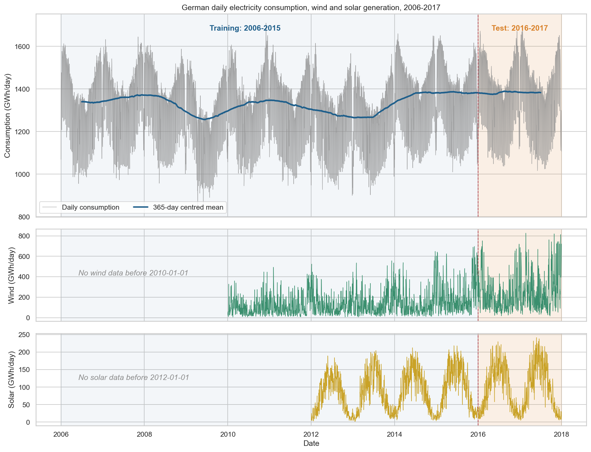

The yearly level shift shows the level of the series. Annual mean consumption fell 7.0% in 2009 (to 1,259.6 GWh/day), drifted down to 1,269.4 in 2013, then jumped 8.8% to 1,381.3 in 2014 and stayed there (1,384.3 in 2015). Comparing each day with the same weekday 52 weeks earlier lists four sustained departures beyond ±5%. Only two are genuine events:

* **Mid-2009 shortfall**: 18 May to 2 October 2009, averaging −9.1% for 138 days. The monthly comparison with 2008 is negative from January (−7.4%) through October (−5.0%), with April the worst month at −16.1%, before recovering to +1.6% in December. April is exaggerated because Easter fell on 12 April in 2009 and on 23 March in 2008.
* **The 2013/14 step**: on regular days the year-on-year change is within ±2% up to 23 December 2013 and above +8% from 14 January 2014, so the step lies inside the Christmas period and cannot be dated to a single day. Mean consumption in the 52 weeks before the step was 1,270.6 GWh/day and 1,381.5 afterwards (+8.7%); six to eleven months later the year-on-year change settles at +7.2%.

The other two departures are echoes: mid-2010 (+8.0%) is the 2009 shortfall dropping out of the comparison base, and late 2014 to early 2015 (+7.4%) is the step dropping out one year later. The step is close to the +6.6% that the documented change in the source's coverage (91% to 97%) would imply, but the explanation is not confirmed.

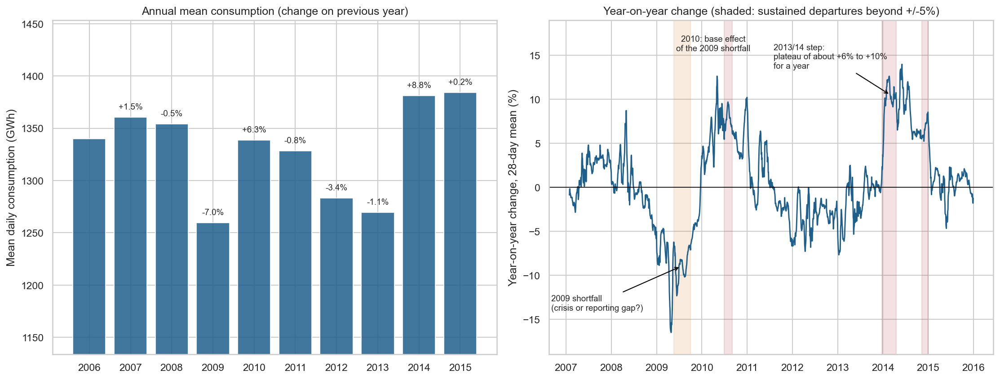

The Seasonal Profiles plot shows the seasonal shape on regular days relative to each year's mean. Consumption is 5 to 8% above the weekly average on weekdays (Monday +5.7%, Tuesday +7.5%, Wednesday +7.8%, Thursday +7.3%, Friday +5.3%) and well below it at the weekend (Saturday −10.2%, Sunday −17.3%). The annual cycle peaks in January (+9.4%) and troughs in August (−6.6%). The test of whether seasonal swings scale with the level of the series is mixed: weekly amplitude favours a multiplicative model (relative spread 0.031 against 0.038 in absolute terms, correlation with level +0.63), while annual amplitude favours an additive one (0.129 against 0.116, correlation −0.17). With ten annual points this has little power, so the choice was left to cross-validation.

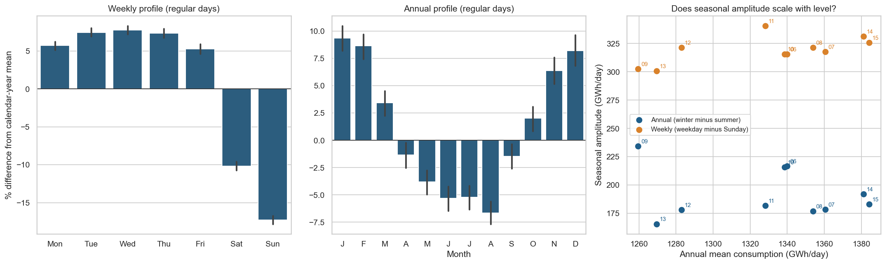

The Holiday Effects charts quantify consumption changes on holidays relative to a normal day of the same weekday. The national holidays reduce consumption by 16 to 28%: Christmas Day −28.2%, Boxing Day −26.9%, New Year's Day −26.7%, Whit Monday −26.6%, Easter Monday −25.9%, 1 May −22.3%, Ascension Day −22.2%, Good Friday −21.3% and German Unity Day −16.2%. Easter Sunday (−8.9%) and Whit Sunday (−7.1%) are not on the national holiday list but clearly differ from an ordinary Sunday, which is why they were added. The Christmas to New Year profile is not uniform: the dip begins around 20 December, reaches roughly 23% on Christmas Eve, 27 to 28% on 25 and 26 December, eases to about 16% between Christmas and New Year, deepens again on New Year's Eve and 1 January (the deepest point, −28.2%), and has largely recovered by 8 January.

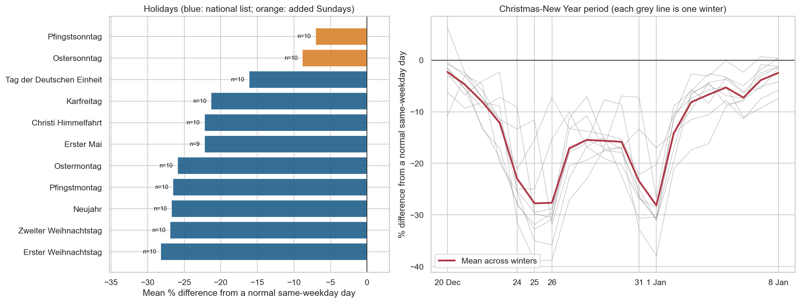

Regressor correlation plots show why raw correlations with wind and solar mislead. Solar correlates −0.248 with consumption, but after removing year level, weekday pattern and annual cycle the correlation is only −0.070 (95% interval −0.120 to −0.018), so most of the raw relationship was the annual cycle. Wind goes from +0.097 to −0.061 (2010 to 2015 window) and from +0.088 to −0.093 (2012 to 2015 window). These adjusted correlations are small, although their intervals exclude zero, and the intervals are optimistic because daily residuals are autocorrelated. Wind output grew from 98.4 GWh/day in 2010 to 212.2 in 2015 (+116%, including a 51% rise in 2015 alone) and solar from 76.2 in 2012 to 95.6 in 2015, which is growth in installed capacity and not in demand.

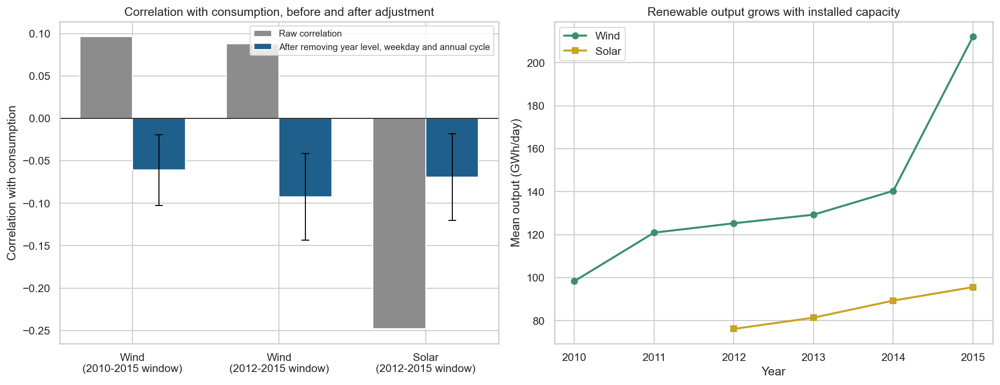

### Baseline Models

The baseline forecasts compare the three baselines with the test data. The weekly SARIMA (M0b) settles into a flat weekly pattern around 1,340 GWh/day within about three months and misses the annual cycle entirely. The seasonal naive forecast (M0a) follows the annual cycle but mistimes the moving holidays: Easter 2016 fell on 27 March, so repeating the previous year's pattern puts the Easter dip in the wrong place. The SARIMAX (M0c) tracks the annual cycle and places the holiday dips correctly. Its estimated level step is +133.4 GWh/day, with a holiday effect of −197.0 GWh/day and a further Christmas-window effect of −160.0. Both ARIMA-family optimisers converged.

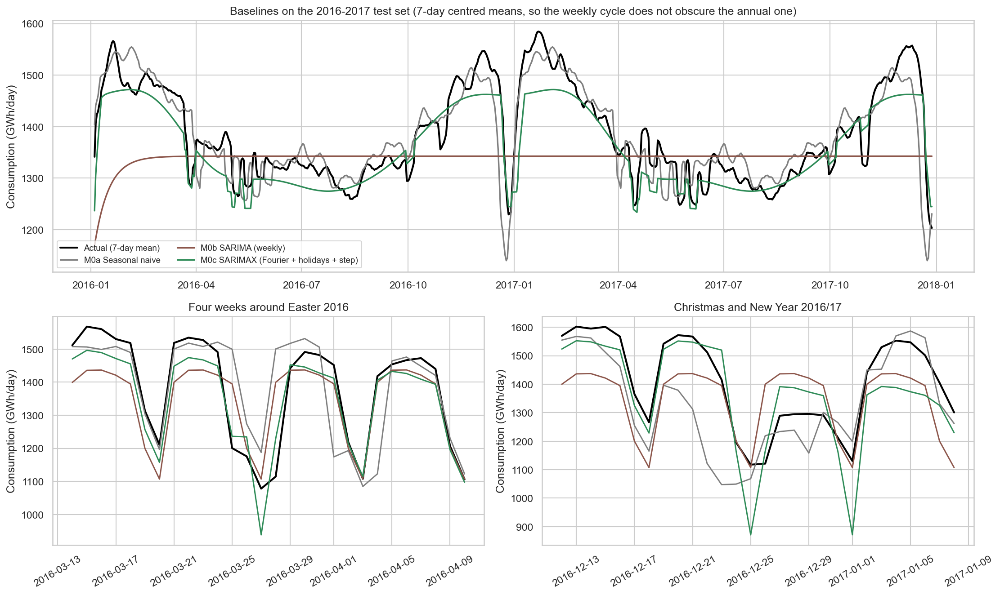

| Model | MAE | RMSE | MAPE (%) | R² | Bias | 95% interval coverage (%) |
| :--- | :--- | :--- | :--- | :--- | :--- | :--- |
| M0a Seasonal naive | 46.98 | 81.09 | 3.50 | 0.75 | +1.93 | not applicable |
| M0b SARIMA (weekly) | 87.03 | 115.55 | 6.20 | 0.49 | −44.32 | 93.43 |
| M0c SARIMAX (Fourier, holidays, step) | 41.88 | 55.81 | 3.02 | 0.88 | −26.33 | 95.35 |

**Prophet Tuning**

The CV Tuning Results visual below shows the mean cross-validated MAPE for all 36 pass-one configurations and the annual Fourier order from the second pass. The best of the 38 configurations (mean MAPE 4.18%, MAE 54.8, RMSE 67.5) is a changepoint_prior_scale of 0.2, a changepoint_range of 0.8, multiplicative seasonality, the level-step regressor and a Fourier order of 15. The top six configurations lie within 4.18 to 4.26%, so the winner is only narrowly best. Averaging over the other choices shows which decisions matter:
* **Level-step regressor**: by far the largest effect: 5.93% without it against 4.83% with it.
* **Changepoint range**: wider is worse (0.8: 4.83%, 0.9: 5.30%, 0.95: 6.02%), the opposite of what the exploratory analysis suggested. The step is handled by the regressor, not by extending the range of the trend.
* **Trend flexibility**: 0.01: 5.08%, 0.05: 5.26%, 0.2: 5.80% on average, although the best configurations use 0.2 or 0.05 once the regressor is present, so the averages mix good and bad combinations.
* **Seasonality mode**: additive 5.44% against multiplicative 5.32%, a small difference.
* **Fourier order**: 6, 10 and 15 give 4.20%, 4.19% and 4.18%, which is negligible.
The two latest folds, the only ones able to show whether a configuration copes with the step, favour a different configuration (changepoint_prior_scale 0.05, last-two-fold MAPE 2.20 to 2.27% against 2.58 to 2.60%). That is examined as a sensitivity check below.

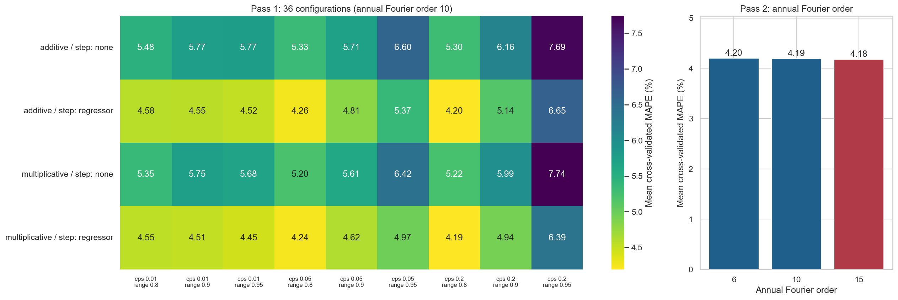

The CV error by horizon visual shows the cross-validated error by forecast horizon and by origin. The tuned model's MAPE is 3.26% over the first 90 days and 4.18% over a full year, against 3.77% and 5.43% for the out-of-the-box Prophet. At individual origins, the tuned model beats the default at all nine: 5.04 against 5.83% (January 2011), 5.90 against 6.02%, 3.31 against 3.58%, 2.85 against 2.97%, 3.93 against 4.61%, 7.70 against 8.15% (July 2013, whose forecast year contains the step), 3.70 against 9.18% (January 2014, just after the step), 2.69 against 3.43% and 2.50 against 5.10% (December 2014). The widest gaps are at the two origins immediately after the step, where the step regressor can be learned.

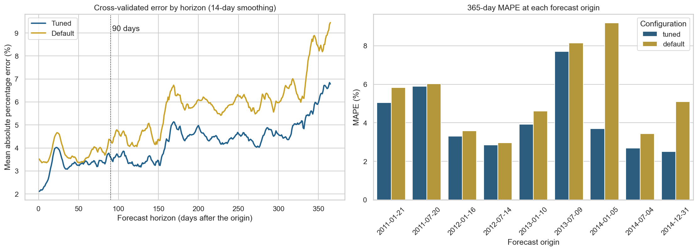

### Prophet Components and Trend

The Prophet Components plot decomposes the tuned model (M1). The weekly effect puts Saturday about 11% and Sunday about 18% below the weekly average, close to the exploratory profile. The annual effect ranges from about −9% in August to about +10% in winter. The learned holiday effects reach 21 to 26% for the major holidays, about 16% for German Unity Day, about 12% for the days between Christmas and New Year and 4 to 7% for the smaller groups of days. The level-step regressor is learned as +7.96%, which sits between the settled year-on-year change (+7.2%) and the before-and-after comparison (+8.7%).

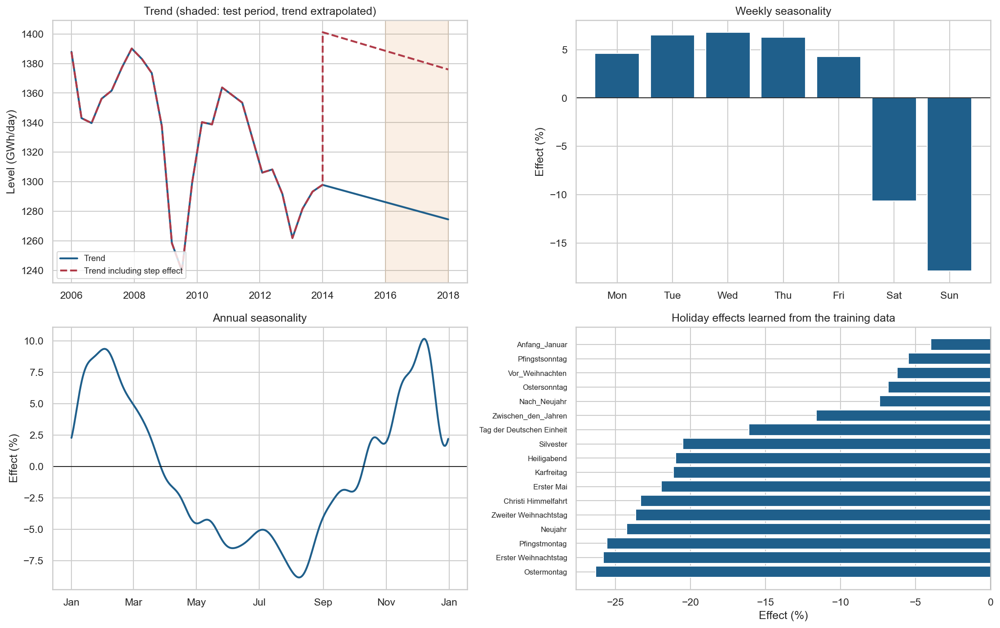

The Trend Changepoint plot shows the fitted trend. Of the 25 candidate changepoints, 23 carry a non-negligible slope change. The six largest are in 2006, late 2008, spring and summer 2009 (slope changes of +1.10 and +1.42 in scaled units), early 2010 and early 2013. The trend therefore follows the 2009 shortfall and the slow decline to 2013, and the step is carried by the regressor (the dashed line in the chart), which lifts the level by about 8% from 1 January 2014. The trend then drifts gently downward across the test period, by 5.8 GWh/day per year. The modelled level sits slightly above the 365-day mean of actual consumption because that mean includes holiday dips, which Prophet models separately.

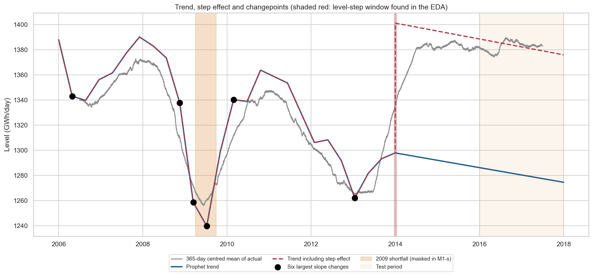

### Test-Set Accuracy

| Comparison | Difference in MAE (GWh/day) | 95% interval | Resamples where first is better |
| :--- | :--- | :--- | :--- |
| M1 against SARIMAX | −10.38 | −13.98 to −6.44 | 100% |
| M1 against out-of-the-box Prophet | −8.77 | −16.03 to −2.11 | 99.45% |
| M1 against seasonal naive | −15.48 | −21.89 to −7.58 | 100% |
| SARIMAX against out-of-the-box Prophet | +1.61 | −8.48 to +10.93 | 42.05% |
| M1 with 2009 masked against M1 | −0.03 | −0.37 to +0.24 | 63.05% |

The tuned Prophet is better than every alternative by margins that exceed test-sample luck. SARIMAX and the out-of-the-box Prophet cannot be separated, which shows that the advantage comes from the tailored configuration and not from using Prophet as such. Masking the 2009 shortfall changes the test MAPE by 0.01 percentage points, so its influence on the point forecast is negligible (it does affect the interval width, which falls from 38.6% to 31.6% of the forecast).

Calendar handling accounts for much of the gain. On ordinary days M1 has a MAPE of 2.04% (SARIMAX 2.64%, out-of-the-box Prophet 2.78%, seasonal naive 2.95%). On the 45 holiday and Christmas-window days its MAPE is 6.17%, against 8.87%, 7.17% and 11.89% for the same three models, and 13.74% for the weekly SARIMA. Every model is considerably less accurate on holidays than on ordinary days.

The Prophet Forecasting Test shows the M1 forecast against the actuals. The forecast follows the weekly and annual cycles closely and reproduces the Christmas to New Year pattern, although it underestimates the recovery in early January. The 95% interval covers 98.4% of test days, well above its nominal level, because it is very wide, averaging 38.6% of the forecast and widening through 2017. Across the 731 days the 28-day average bias of M1 is generally small, while the weekly SARIMA drifts by up to about 200 GWh. All models under-forecast around the turn of 2016/17.

By forecast horizon band (descriptive only, because every band comes from one origin and horizon is confounded with season), M1's MAPE is 2.23% for days 1 to 90, 2.09% for days 91 to 365 and 2.47% for days 366 to 731. The procurement buffer, the 95th percentile of the shortfall of the forecast against actual demand, is 4.82% of the forecast (75.6 GWh/day) in the first band, 3.99% (56.2 GWh/day) in the second and 5.71% (81.0 GWh/day) in the third, with the corresponding 95th percentile over-forecast at 3.79%, 3.64% and 2.73%. The out-of-the-box Prophet has smaller buffers (about 2.7 to 3.0%) only because it over-forecasts on average (bias +25.5 GWh/day, 95th percentile surplus 5.2 to 7.2%), which would leave a retailer holding unneeded volume. The cross-validated horizon figures (3.26% over 90 days and 4.18% over 365) are the sounder answer to the question about 90 and 365 days ahead, and they are higher than the test-set MAPE because their folds include the 2013/14 step, which no model could foresee.

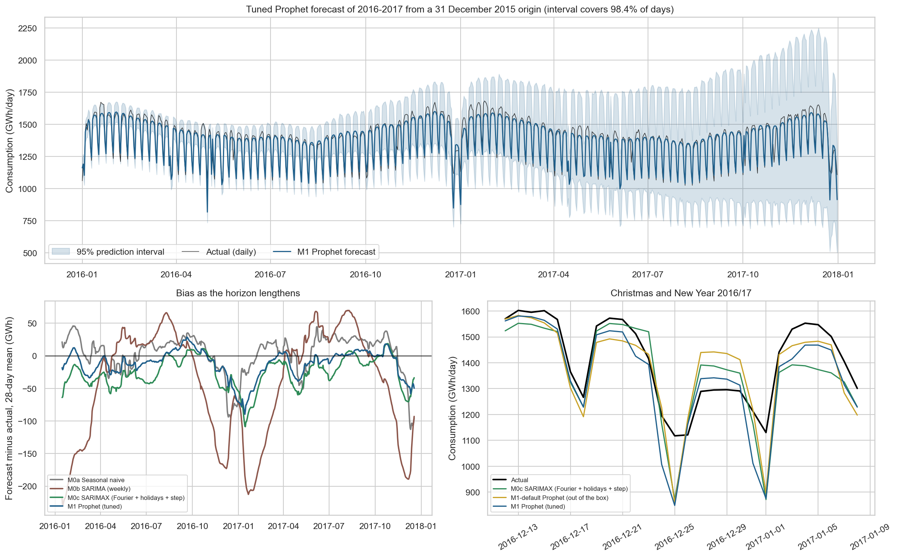

The Residual Diagnostics plot shows the in-sample residuals of M1. They have a mean of −0.02 GWh and a standard deviation of 40.7 GWh, with a symmetric distribution and heavy tails (a few residuals reach ±300 GWh). They are strongly autocorrelated: lag 1 is 0.57 and lag 7 is 0.25, and the Ljung-Box statistics of 2,158.9, 2,311.6 and 2,340.6 at lags 7, 14 and 28 all have p-values of effectively zero. Unlike the near-white-noise residuals of the ARIMA project, Prophet's residuals retain day-to-day structure that the model does not capture.

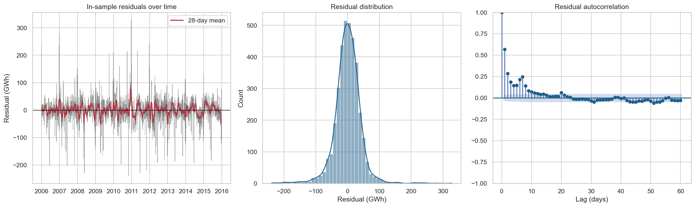

### Wind and Solar Regressor Experiment

The experiment was run three times, as described in the Methodology. The first run used the hyperparameters tuned for M1 on every window.

_Primary run_ (shown in the following three charts). On the six-year window (2010 to 2015), adding wind (M2) changes MAE by −0.08 GWh/day against its matched baseline (interval −0.82 to +0.73). Placebo regressors, the rotated series described in the Methodology, change the MAE by between −0.31 and +0.28 (median +0.09), and 1 of 10 placebos did at least as well as the real wind series, so the real change lies inside the placebo range. The four-year models told a different story: the core model M1-W12 reached an MAE of 97.22, M2b 91.60 and M3 94.57, against about 31 for M1. The stability screen explains why. The fitted trends of the three four-year models drift by −60.8, −56.5 and −58.4 GWh/year across the test period, against −5.8 for M1 and well beyond the ±20 GWh/year limit. The apparent improvements from adding regressors to this unstable baseline (−5.62 and −2.65 GWh/day, intervals excluding zero) are therefore artefacts of the baseline's failure, and are excluded from the hypothesis verdicts. Only one comparison (M2 against M1-W10) is sound in this run, and it supports H1.

The Regression Coefficients plot shows the learned effect of a one-standard-deviation rise in each series (as a percentage of consumption) against the placebo effects: wind −0.21% (M2), −0.27% (M2b) and −0.31% (M3), and solar −0.54%.

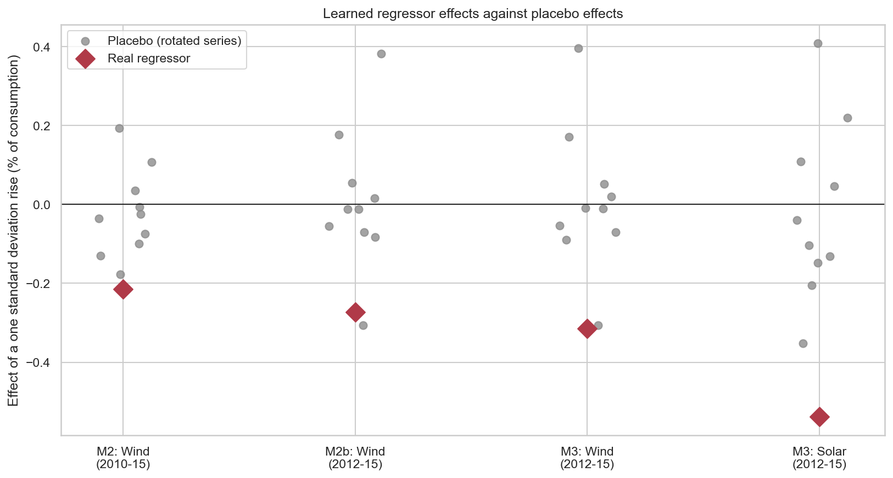

The Regressor Experiment Comparison visual shows the test MAE of each model and, as a forest plot, each paired comparison with its 95% bootstrap interval and the placebo changes. Comparisons that involve an unstable model are drawn in red.

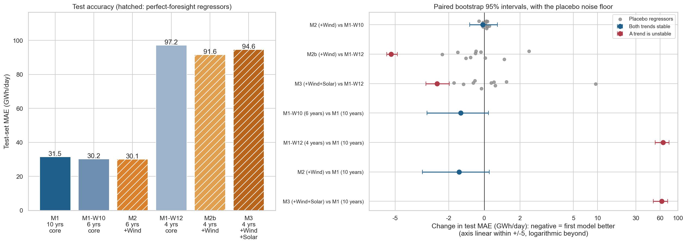

 The Residuals vs Regressors plots give an independent check, relating M1's test-period forecast errors to wind and solar after removing year level, weekday and annual cycle. For wind the adjusted correlation is +0.042 (interval −0.031 to +0.114), and the scatter is flat. For solar it is −0.179 (interval −0.248 to −0.108), with a slight downward slope, so higher solar output goes with somewhat lower actual consumption than M1 forecast. The relationship explains about 3% of the variance of M1's errors, and the interval is optimistic because daily errors are autocorrelated.

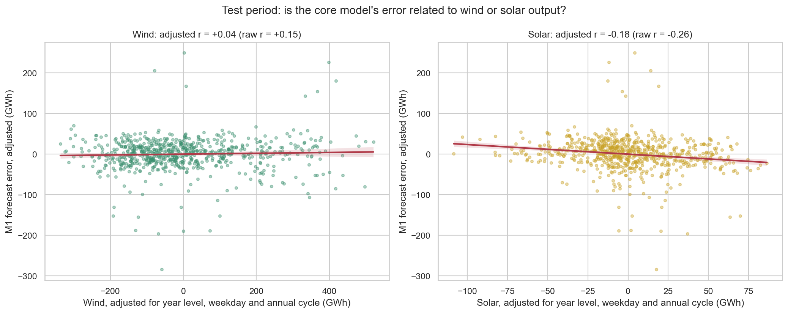

The Trend Instability Reruns plots compare the three runs. Reducing the changepoint_prior_scale to 0.05 improved the four-year core model (MAE 56.4 against 97.2) but its trend still drifted −31.9 GWh/year, beyond the limit, and the M2b and M3 models (MAE 54.1 and 61.0, drifts −29.8 and −34.9) remained unstable. Matching the changepoint range to each window removed the problem: the four-year models then score MAEs of 30.94 (M1-W12), 31.25 (M2b) and 30.90 (M3), with drifts of +1.4, +3.0 and +3.8 GWh/year, and the six-year models 30.04 (M1-W10) and 30.13 (M2) with drifts of −2.6 and −1.1. All six models in this run pass the stability screen, and M1, whose range already works out at 0.80, is unchanged. The cause of the instability was therefore the trend's final stretch of history, not the flexibility of the trend as such.

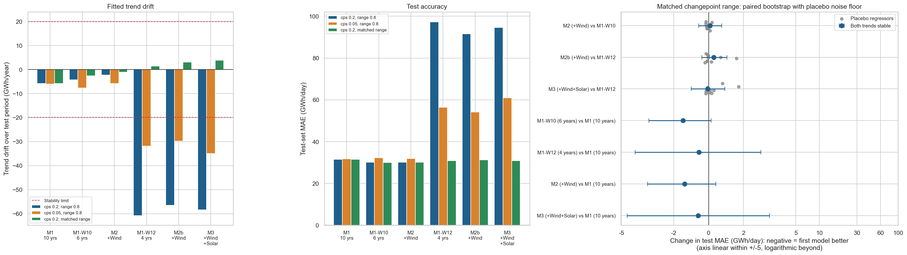

| Comparison (matched-range run) | Change in MAE (GWh/day) | 95% interval | Placebo range for the change | Placebos at least as good |
| :--- | :--- | :--- | :--- | :--- |
| M2 (+Wind) against M1-W10 | +0.08 | −0.57 to +0.75 | −0.15 to +0.18 | 90% |
| M2b (+Wind) against M1-W12 | +0.30 | −0.39 to +1.05 | −0.20 to +1.59 | 80% |
| M3 (+Wind +Solar) against M1-W12 | −0.05 | −0.99 to +0.93 | −0.16 to +1.72 | 80% |

In the sound run, none of the three regressor comparisons shows an improvement: every 95% interval includes zero, and 80% to 90% of the placebo regressors performed at least as well as the corresponding real-regressor result.

H1 is supported: even with perfect knowledge of future wind and solar output, adding them does not improve the forecast by more than about 1 GWh/day (3% of the MAE).

The Learned Regressor Effects against Placebo Effects plot repeats the coefficient comparison using this sound run. The learned effects are −0.220% (wind, M2), −0.272% (wind, M2b), −0.313% (wind, M3) and −0.542% (solar, M3). Against the placebo ranges, the M2b wind effect lies within the placebo range (−0.280 to +0.399), the M2 and M3 wind effects lie only just outside it (−0.180 and −0.276 are the most negative placebo values), and the solar effect lies outside (placebo range −0.363 to +0.442). With 10 placebo draws these are suggestive, not conclusive. A solar effect of −0.54% corresponds to only about 7 GWh/day for a one-standard-deviation rise, which is small beside an MAE of about 31 and consistent with the lack of any measurable gain in forecast accuracy.

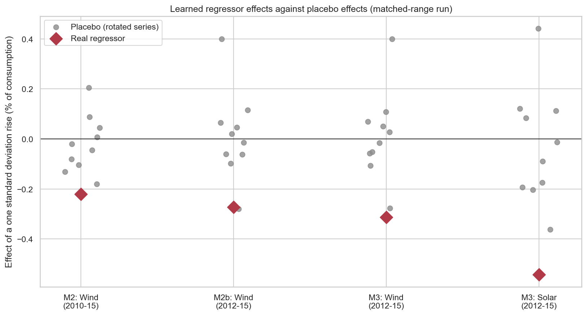

For H2, the cost of a shorter history, the six-year window is not worse than the ten-year one (M1-W10 against M1: −1.46 GWh/day, interval −3.43 to +0.15; 96% of bootstrap resamples favour the shorter window) and neither is the four-year window (−0.56, interval −4.21 to +3.00). Adding the regressors on those windows leaves them equally close to M1 (M2: −1.37, M3: −0.60). H2 is not supported: nothing is lost by using the shorter window.

The All Model Comparison plot ranks every model by test MAPE, using the matched-range versions of the shorter-window models. The Prophet models fitted on 4, 6 or 10 years, with or without regressors, all lie between 2.22 and 2.35% (MAE 30.0 to 31.5) and cannot be separated from one another. The fully tuned M1 (2.30%) and M1-s (2.29%) sit within this group. The sensitivity model tuned on the last two folds (M1-t) scores 2.40% (MAE 32.97), which is worse than M1 by 1.48 GWh/day (interval +0.42 to +2.59), so the selection rule fixed in advance was not beaten by the alternative. Behind this group come SARIMAX (3.02%), the out-of-the-box Prophet (3.05%), the seasonal naive forecast (3.50%) and the weekly SARIMA (6.20%).

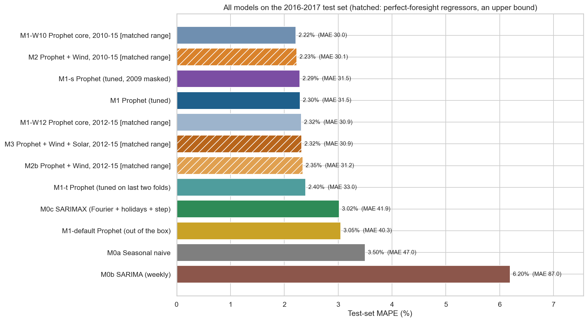

### Air Passengers Bridge

The re-run of the two ARIMA models reproduces the figures published on the ARIMA page exactly (ARIMA(12,1,12): MAE 32.34, R² 0.724, MAPE 6.96%; ARIMA(12,2,12) on Box-Cox data with lambda 0.045: MAE 14.89, R² 0.947, MAPE 3.46%), which confirms that the data and the 115/29 split are identical. Neither ARIMA optimiser fully converges. Cross-validation chose multiplicative seasonality, a changepoint_prior_scale of 0.05 and an annual Fourier order of 3 for the tuned Prophet (mean cross-validated MAPE 7.13%). On average, multiplicative configurations scored 7.66% against 9.15% for additive, and the two default configurations scored 7.25% (multiplicative) and 8.41% (additive).

| Model | MAE | RMSE | MAPE (%) | R² | Bias | 95% interval coverage (%) |
| :--- | :--- | :--- | :--- | :--- | :--- | :--- |
| ARIMA(12,1,12), untransformed | 32.34 | 41.04 | 6.96 | 0.72 | −24.15 | 65.52 |
| ARIMA(12,2,12), Box-Cox | 14.89 | 17.98 | 3.46 | 0.95 | +2.56 | 100.00 |
| Prophet, additive (defaults) | 33.90 | 41.33 | 7.72 | 0.72 | +2.56 | 51.72 |
| Prophet, multiplicative (defaults) | 18.82 | 23.31 | 4.15 | 0.91 | −7.90 | 62.07 |
| Prophet, Box-Cox + additive | 24.01 | 29.82 | 5.14 | 0.85 | −13.26 | 82.76 |
| Prophet, tuned by cross-validation | 16.17 | 19.93 | 3.95 | 0.93 | +4.23 | 72.41 |

The six Air Passengers Forecast plots show the six forecasts against the same 29 test months. The Test-Set MAE and Test-Set MAPE charts and compare their errors with the published ARIMA figure. 

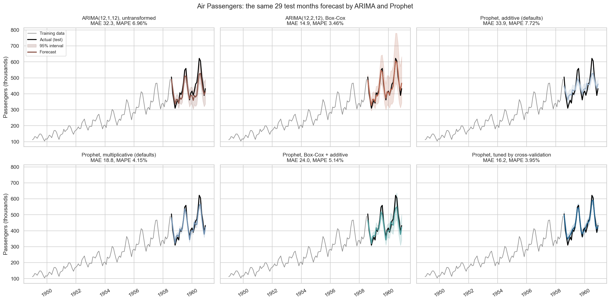

The Test-Set MAE and Test-Set MAPE charts compare the errors of the four Prophet models with the published ARIMA figure.

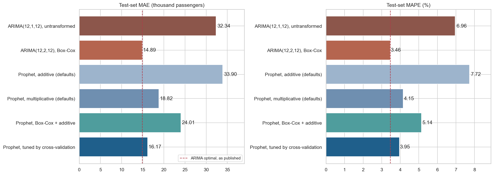

Because there are only 29 test points, the paired block bootstrap (three-month blocks) is needed to judge the differences:

| Comparison (first against second) | Difference in MAE (thousand passengers) | 95% interval |
| :--- | :--- | :--- |
| Prophet additive against ARIMA baseline | +1.57 | −14.16 to +12.35 |
| Prophet multiplicative against Prophet additive | −15.08 | −20.90 to −7.93 |
| Prophet tuned against ARIMA optimal | +1.28 | −2.18 to +7.16 |
| Prophet tuned against Prophet multiplicative (defaults) | −2.65 | −9.12 to +3.41 |
| Prophet Box-Cox against ARIMA optimal | +9.12 | +2.97 to +18.91 |
| Prophet Box-Cox against Prophet multiplicative | +5.19 | +1.64 to +9.00 |

Three findings emerge. First, handling seasonality that grows with the series is what matters: multiplicative seasonality improves Prophet's MAE by 15.1 thousand passengers over additive, mirroring the improvement the Box-Cox transformation gave ARIMA, and additive Prophet is no better than the untransformed ARIMA. Second, tuned Prophet (MAE 16.17) and the optimal ARIMA (14.89) cannot be told apart. Third, applying the same Box-Cox transformation to Prophet did not help: at default settings that variant is worse than both the optimal ARIMA and Prophet's own multiplicative mode, and it under-forecasts (bias −13.3); this variant was not tuned, and the reason was not investigated. The 95% intervals behave differently from the electricity models: Prophet's cover only 52 to 83% of the test months (72% for the tuned model), while the optimal ARIMA's cover 100% at an average width of 39% of the forecast.

The trend and annual seasonality plots of the air passenger components show the tuned Prophet's trend, which rises almost linearly from about 110 to 490 thousand passengers, and its annual seasonal effect. The effect is concentrated in summer: July and August are 23.8% above trend and June 10.1% above, while November (−15.4%), December (−12.9%), October (−10.7%) and January (−10.7%) are the lowest months, in line with the multiplicative decomposition on the ARIMA page (about +20% in July and August and about −10% in November and January).

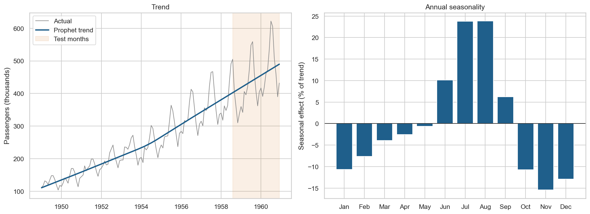

## Conclusions:

The primary conclusion is that a carefully configured Prophet model provides an effective basis for forecasting the German daily electricity series used in this project. On the 731 held-out days in 2016 and 2017, its forecasts have a MAPE of 2.30% and an MAE of 31.5 GWh/day. Across the more demanding walk-forward validation, which tests forecasts from nine earlier origins and includes the unforeseeable 2013/14 level shift, MAPE is 3.26% over the first 90 days and 4.18% over a full year. These cross-validated figures provide the stronger evidence for the original 90- and 365-day forecasting questions because they test the approach from multiple forecast origins rather than a single two-year holdout.
  
Prophet's advantage is not automatic. The tuned model reduces MAE by 10.4 GWh/day relative to the SARIMAX model given comparable calendar and level-step information, with a 95% paired block-bootstrap interval of 6.4 to 14.0 GWh/day. In contrast, SARIMAX and the out-of-the-box Prophet cannot be distinguished. The improvement therefore comes from configuring the model appropriately for the structure of this series, particularly its holiday effects and 2013/14 level shift, rather than simply choosing Prophet as the forecasting technique.

For the model run with an origin of July 2013, the forecast year contained the 2013/14 shift, which no model could have foreseen. The per-origin one-year errors show this, noting that the forecasts with earlier origin had less history:

| Origin | One-year error |
| :--- | :--- |
| Jan 2011 | 5.04% |
| Jul 2011 | 5.90% |
| Jan 2012 | 3.31% |
| Jul 2012 | 2.85% |
| Jan 2013 | 3.93% |
| Jul 2013 (shift inside forecast year) | 7.70% |
| Jan 2014 (just after the shift) | 3.70% |
| Jul 2014 (shift already seen) | 2.69% |
| Dec 2014 (shift already seen) | 2.50% |
  
For the energy retailer in the scenario, the held-out period suggests a procurement buffer of approximately 4 to 6% above the forecast to limit demand exceeding the hedged amount to about one day in twenty. This is an empirical baseline rather than a guaranteed production buffer: 2016 and 2017 contained no comparable structural break, and the earlier cross-validation shows how sharply error can increase when the underlying data changes unexpectedly.

**Summary of conclusions**

| Business question | Conclusion | Strength of evidence |
| :--- | :--- | :--- |
| How accurate are forecasts 90 and 365 days ahead? | About 2.3% average error on the two held-out years (a calm period). The harder test from nine earlier forecast dates gave 3.3% over 90 days and 4.2% over a year. The two dates after the 2013/14 shift gave 2.5 to 2.7% over a year. | Strong |
| How large a buffer should be held? | In the test years, a buffer of 4.0 to 5.7% above the forecast (56 to 81 GWh/day, depending on how far ahead) covered demand on 19 days in 20. Treat this as a minimum. | Moderate: one forecast date, no structural break in the period |
| Is Prophet better than classical methods? | Yes, when tailored to the data: average error about 25% smaller than a classical seasonal model given the same calendar information. Used out of the box, it was no better. | Strong: the gap is larger than test-period luck |
| What drives the accuracy? | Telling the model about holidays and about the 2013/14 break. Fine-tuning its internal settings mattered far less. | Strong |
| Are wind and solar data worth acquiring for demand forecasts? | No. Even if their future values were known exactly, forecasts improved by no more than about 1 GWh/day (3% of the error). | Strong within this dataset and experimental design for 'no useful gain'; the small link between solar output and demand is only suggestive |
| How much history is needed? | Six years performed as well as ten, and four years did too once the model was configured sensibly. | Moderate |
| Where does it struggle? | Holidays (error three times larger than on ordinary days), structural breaks in the data, and its own uncertainty ranges, which are unreliable. | Strong |
| Does it beat ARIMA on the Air Passengers series? | No detectable difference. What mattered for both was allowing the seasonal swings to grow with the series. | Moderate: only 29 test months |

**What this means for the procurement team**

- **Use the forecast as a planning baseline, not as a guaranteed demand figure.** The tuned model provides a credible basis for forward volumes, but the observed 4 to 6% buffer applies to the stable 2016–17 holdout period. Greater protection would be appropriate when structural change is suspected.
- **Give holidays additional attention.** M1's MAPE rises from 2.04% on ordinary days to 6.17% on holidays and the Christmas to New Year period, making these dates particularly suitable for additional review.
- **Monitor the input data as closely as the model.** The largest challenge in the project is the approximately 8.7% level shift around the turn of 2013/14. A change in the data-generating or reporting process can matter more than incremental model improvement.
- **Do not acquire wind and solar generation data solely on the evidence of this demand-forecasting experiment.** Even when their future values are supplied perfectly, they provide no detectable improvement in forecast accuracy. This does not address their potential value for other applications, such as forecasting generation or wholesale prices.
- **Base operational risk limits on observed forecast errors rather than Prophet's built-in uncertainty intervals.** The intervals are too wide for the electricity holdout and too narrow for much of the Air Passengers comparison, so their nominal 95% coverage should not be interpreted as a reliable operational limit.

**What the project shows about the technique**

Prophet's principal advantage in this application is interpretability. It separates the forecast into trend, weekly and annual seasonality, holidays and explicitly supplied regressors, allowing individual components to be inspected and related back to the structure of demand. The project also demonstrates three important limitations. First, configurations are not automatically portable between different amounts of training history: the four-year models initially produced unstable trend extrapolations until the changepoint range was adjusted. Second, significant short-run autocorrelation remains in the residuals, so in this project Prophet is better suited to the medium- and long-horizon planning problem than to next-day forecasting unless another short-term component is introduced. Third, its built-in uncertainty intervals require independent validation rather than being accepted at face value.

More broadly, the analysis reinforces the importance of evaluating the forecasting process rather than selecting a model from a single accuracy figure. The chronological holdout, walk-forward validation, paired block bootstrap, matched regressor baselines, placebo tests and sensitivity analyses expose weaknesses that a single train/test comparison would miss. Several findings also run against the initial expectations, including the lack of forecasting value from wind and solar generation and the instability caused by transferring one Prophet configuration to a shorter training window. Retaining these results is part of the evidence rather than a failure of the analysis.

**Limitations**

- The headline holdout accuracy comes from one forecast origin and two years without a structural break, so it should not be interpreted as a guaranteed future error rate.
- National electricity consumption is used as a proxy for the hypothetical retailer's demand, and only national holidays are modelled.
- The cause of the 2013/14 level shift is not confirmed, while the 2009 shortfall remains unexplained; masking the latter has negligible effect on the primary point forecast.
- The wind and solar experiment represents a best-case test because their future values are supplied to the models.
- The conclusions are based on one national electricity dataset and one benchmark forecasting series rather than evidence that Prophet will perform similarly on other datasets.

**Connections to the rest of the portfolio**

This project extends the portfolio's earlier time-series work from description and classical forecasting into a more complex daily forecasting problem. The [Moving Averages](/moving-averages/) project characterises historical movement, while the [ARIMA](/arima/) project introduces out-of-sample forecasting and provides the Air Passengers benchmark reused here. The input validation follows the discipline demonstrated in the [Great Expectations](/great-expectations/) project, while the chronological testing, explicit separation of training and test data, and reporting of null and unexpected findings reflect the principles set out in the [Data Science Workflow](/data-science-workflow/) and [Ethics in Applied Data Science](/data-science-ethics/) pages.

## Next steps:  

This project demonstrates a forecasting workflow on public data. A real deployment would involve things the portfolio script cannot replicate: a live data feed, the retailer's own customer demand, wholesale prices and hedging instruments, and a team that acts on the forecast each day. The extensions below describe what that next stage would involve, in rough order of business value.

* **Add temperature**. Weather is probably the most important driver of demand missing from this dataset, because heating and cooling needs move consumption directly. This hypothesis was neither tested nor proven as part of this project. Temperature is not known a year ahead, so longer horizons would use seasonal norms or weather scenarios, and short horizons would use weather forecasts. The same discipline applied to wind and solar here, a matched baseline, placebo regressors and a paired bootstrap, would show whether it genuinely improves the forecast.
* **Turn forecast error into a purchasing cost**. The buffer here is set from observed forecast errors. With real wholesale prices, the buffer could be chosen to minimise the combined cost of being short (buying at spot prices) and of being long (holding surplus volume), which are rarely equal. The uncertainty ranges would also be replaced by ranges built directly from observed errors, separately for ordinary days, holidays and different horizons, because Prophet's built-in ranges were unreliable.
* **Use the retailer's own demand**. National consumption stands in here for the retailer's customers. A real forecast would use the retailer's metered demand, split by customer type (households and businesses), and allow for customer growth and churn. It would also use regional holidays and school calendars, which the national series cannot separate.
* **Reduce the holiday errors**. Error on holidays was about three times that on ordinary days. Bridge days between a holiday and a weekend, regional holidays and special events are natural additions, together with a review step in which planners check forecasts for those periods.
* **Monitor the data and retrain**. The largest error in this project came from a shift in the recorded level of demand, not from the model. In production, each new data load would be validated automatically (in the way built in the [Great Expectations](/great-expectations/) project), with an alert if the level of demand moves unexpectedly. The model would be re-tested against recent actuals on a regular schedule and re-fitted at least annually or whenever a break is detected.
* **Test on recent data**. The series ends in 2017. Extending it to the present would be a far tougher test of the approach, because it would include the 2020 pandemic and the 2022 energy-price crisis, both of which changed demand patterns abruptly.
* **Combine models and capture short-term momentum**. Prophet does not capture the way one day's error carries into the next. A hybrid, in which a second model forecasts Prophet's remaining errors, or an average of Prophet and SARIMAX forecasts, could improve shorter horizons. This matters less for forward purchasing a quarter or a year ahead than for day-ahead decisions.

## Python code:
You can view the full Python script used for the analysis here:  
[View the Python Script](/Prophet_Seasonal_Forecasting_OPSD_v6.py)

## Data Source & Acknowledgments

This project utilizes daily German electricity consumption, wind, and solar generation time-series data covering the years 2006 to 2017.

* **Primary Source:** Open Power System Data (OPSD). *Data Package Time Series*.  
  Website: [https://open-power-system-data.org/](https://open-power-system-data.org/)
* **Repository:** Derived via the [jenfly/opsd](https://github.com/jenfly/opsd) GitHub repository.
* **Licensing:** The underlying processing code is released under the **MIT License**, and the dataset is provided under the **Creative Commons Attribution 4.0 International (CC BY 4.0)** license.
